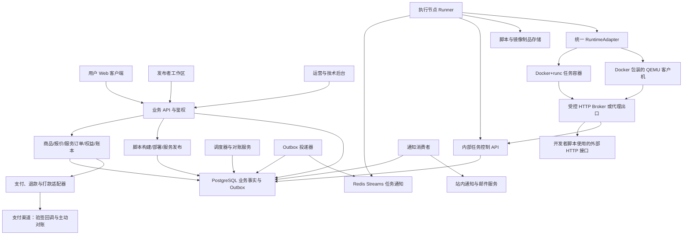
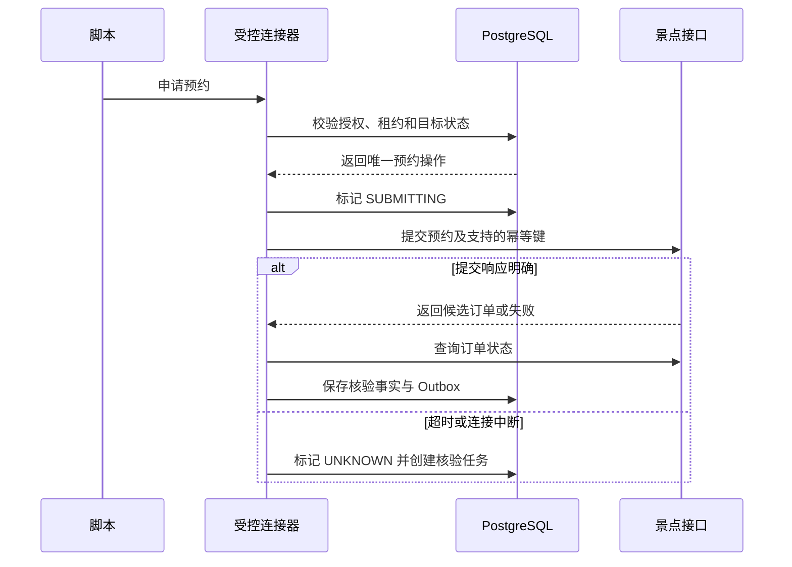

# Script Tools 系统架构与详细设计

版本：V3.0 / 2026-11-14。状态：设计与静态契约基线，基础工程实施中，运行与部署验收按05记录。

本文维护架构决策、模块边界、状态转换、不变量及恢复语义。具体模块实现、页面操作与事务算法集中在[详细开发设计](./06-详细开发设计.md)；完整物理字段、约束、索引和DDL集中在[数据库设计](./07-完整系统数据库设计.md)。消息与SDK协议见03，部署参数和运维操作见04。

[文档导航](./README.md)

- [1. 架构决策](#decisions)
- [2. 参考依据与采用边界](#references)
- [3. 总体架构与技术栈](#overview)
- [4. 服务与信任边界](#boundaries)
- [5. 系统不变量](#invariants)
- [6. 入口、出口与责任交接](#flows)
- [7. 脚本发布、构建与试运行](#publishing)
- [8. 导入状态与封存适配](#imports)
- [9. 任务、调度、领取与并发](#tasks)
- [10. Run、Attempt 与结束判定](#run-states)
- [11. 外部效果、业务可信度与结果接受](#effects)
- [12. 人工接续、撤权与结案竞态](#continuations)
- [13. 执行模式解析](#runtime)
- [14. Docker 执行环境](#docker)
- [15. QEMU、KVM 与 TCG](#qemu)
- [16. HTTP 出口、凭据与可选连接器](#network)
- [17. 持续运行、停止与安全恢复](#continuous)
- [18. 多批次产物与去重](#batches)
- [19. 上传、产物、生成与集合状态](#output-states)
- [20. 检查点与产物的原子交接](#checkpoints)
- [21. 通知、附件与外部投递](#notifications)
- [22. 事务、事件与幂等](#transactions)
- [23. 实体、字段、约束与迁移](#database)
- [24. 账号、凭据与注销生命周期](#accounts)
- [25. 旅行场景的一致性设计](#travel)
- [26. 故障恢复与环境回收](#recovery)
- [27. 安全与隐私约束](#security)
- [28. 商品、按次交易、权益与结算状态机](#commerce-architecture)

<a id="decisions"></a>

## 1. 架构决策

| 决策 | 内容 | 原因 |
| --- | --- | --- |
| ADR-01 | 面向公开注册的 To C 个人账号平台 | 不引入租户、组织、成员模型；私有数据直接归属用户 |
| ADR-02 | 只承载 HTTP/HTTPS 脚本 | 去除浏览器和桌面环境，统一网络与脚本协议 |
| ADR-03 | 两类后端、三种执行方式 | Docker 后端；QEMU 后端分别使用 KVM 或 TCG |
| ADR-04 | 默认 `docker`，固定使用 runc | 遵循最终确认的 vm2api 容器参考方案 |
| ADR-05 | 控制服务与执行节点分开部署 | Docker 管理权限和用户代码不进入业务服务主机 |
| ADR-06 | 一个执行尝试一个专属环境 | 防止用户之间的文件、进程、缓存和会话串用 |
| ADR-07 | 业务状态以 PostgreSQL 为事实源 | 队列可以重投，但任务、授权和订单不能依赖临时消息存活 |
| ADR-08 | 交易、执行和业务场景分层 | 所有付费服务有service_order；只有预约场景有booking_order；运行事实独立 |
| ADR-09 | 通用 HTTP 出口与可选可信连接器分层 | 新业务脚本直接使用 HTTP SDK；需要专门核验的业务再绑定连接器 |
| ADR-10 | 初期模块化单体控制服务，Runner 独立 | 降低运维复杂度，同时保留扩展边界 |
| ADR-11 | 日志、指标、追踪与业务审计分工明确 | 日志不代替订单事实，采样不影响关键操作审计 |
| ADR-12 | 普通日志先脱敏再持久化，归档与检索解耦 | 允许追踪延迟、重放和缺口，不承诺节点故障下零丢失 |
| ADR-13 | 发布者输入输出 JSON Schema 随脚本及动作版本固定 | 开发者独立定义数据；平台统一执行信封与校验流程，不固定业务字段 |
| ADR-14 | 自定义业务动作与标准生命周期 Hook 分离 | actions 动态注册任意业务功能；hooks 提供固定生命周期扩展点，无封闭业务动作白名单 |
| ADR-15 | 通用任务独立于业务扩展，新增脚本无需修改核心代码 | 执行配置绑定脚本版本、动作、输入、计划及权限，付费服务额外绑定订单和权益；旅行对象通过扩展表关联核心 |
| ADR-16 | 一次调用可反复产生独立产物批次 | 文本、JSON、文件与消息共用产物服务；批次/业务结果/投递分开 |
| ADR-17 | finite 与 continuous 执行并存 | 持续租约、检查点与有界停止支撑长期驻留，不用 Cron 重建环境模拟 |
| ADR-18 | 四工作区前端统一 React + TypeScript + Vite + Ant Design；RJSF优先原型验证 | 2026-11-14用户确认；前端框架已选定，表单库的方言覆盖、渲染行为和依赖版本须通过专项验收 |

本版不内置 gVisor、Kata、Firecracker，不使用“安装 gVisor”作为公开运行的隐含前提。Docker 模式共享宿主内核，其风险通过执行节点隔离、权限、网络、资源与持续修补共同控制，不能宣传为与 KVM 相同的隔离边界。

<a id="references"></a>

## 2. 参考依据与采用边界

### 2.1 核对版本

参考仓库为 `dofastted/vm2api`，固定核对提交为 `381dbe082fef1a598c9569f80edbe26c53cd39e3`。以下结论针对该提交，不推断其他部署的宿主配置。

| 文件 | 已核对事实 | 本项目采用方式 |
| --- | --- | --- |
| [runtime-kind.mjs](https://github.com/dofastted/vm2api/blob/381dbe082fef1a598c9569f80edbe26c53cd39e3/src/lib/vm/runtime-kind.mjs) | 顶层类型为 `docker`、`kvm`，默认 Docker | 保留两个后端；本项目 API 单独表达三种执行方式 |
| [vm-runtime.mjs](https://github.com/dofastted/vm2api/blob/381dbe082fef1a598c9569f80edbe26c53cd39e3/src/lib/vm/vm-runtime.mjs#L1236) | Docker 启动包含只读根目录、capabilities 限制、资源与进程限制 | 参考加固结构，由可信 Runner 生成配置 |
| [kvm-host.mjs](https://github.com/dofastted/vm2api/blob/381dbe082fef1a598c9569f80edbe26c53cd39e3/src/lib/vm/kvm-host.mjs) | 检查 KVM 可用性，读取 `allow_tcg` 决定是否允许软件模拟 | 探测方式参考；本项目进一步区分硬件不可用与管理链路异常 |
| [kin-kvm-entry](https://github.com/dofastted/vm2api/blob/381dbe082fef1a598c9569f80edbe26c53cd39e3/docker/kin-kvm/kin-kvm-entry) | Docker 内启动 QEMU，使用 KVM 或 TCG，准备客户机磁盘与启动材料 | 参考包装、overlay 和生命周期；改成任务专属客户机 |

vm2api 的 Docker 启动代码未指定 gVisor；它使用宿主 Docker 的默认运行时。Script Tools 为避免环境漂移，明确指定或验证 `runc`。QEMU 外层容器只是管理包装，客户机隔离由 QEMU 的虚拟机边界提供；KVM 与 TCG 的加速机制不同。[Docker 运行时说明](https://docs.docker.com/engine/daemon/alternative-runtimes/)、[QEMU 说明](https://www.qemu.org/docs/master/system/introduction.html)

### 2.2 需要适配的差异

- vm2api 的槽位可长期存在；本项目任务配置长期保存，执行环境按 Attempt 创建和销毁。
- 参考 QEMU 和容器生命周期，不引入其模型代理、账号身份等无关业务。
- 不把控制平面的 Docker socket、数据库配置、平台密钥和主机网络交给用户任务。
- 不照搬跨任务可写 home/run 共享目录；任务工作目录与客户机磁盘必须独立。
- KVM 探测因 Docker 管理服务失联、认证失败或镜像错误而失败时，优先报告管理故障，不能借 TCG 回退掩盖问题。

### 2.3 源码授权

该提交的 [LICENSE](https://github.com/dofastted/vm2api/blob/381dbe082fef1a598c9569f80edbe26c53cd39e3/LICENSE) 对商用要求另行书面授权。本文件是架构参考和独立设计，不包含 vm2api 源码复制，也不构成已取得授权的声明。本项目现已明确商业化定位；如直接复用源码，实施前须核对适用于商用的条款与授权证据，当前没有取得授权的声明。

### 2.4 青龙能力的取舍

| 青龙的参考能力 | 本项目采用方式 | 本项目约束 |
| --- | --- | --- |
| 脚本编辑、仓库/单文件同步 | 草稿编辑、导入检查、版本差异、更新提醒 | 导入只生成候选内容，不发布或迁移任务；共享脚本不能读取使用者数据 |
| 环境变量、依赖管理 | Schema 参数映射、本人凭据绑定、隔离构建与依赖诊断 | 无全站业务环境变量池；运行时不安装依赖，不修改封存制品 |
| 执行前后扩展 | 提供标准 before_action/after_action 模板、独立阶段日志 | 跟随 ScriptVersion 固定，失败语义遵循[系统不变量](./02-系统架构与详细设计.md#invariants)；不开放任意宿主 Shell 命令 |
| 任务列表与日志操作 | 搜索、标签、个人置顶、手动运行、暂停后续、停止当前、跳转本次日志 | 所有操作经过同一授权、并发和幂等入口；列表提交成功不表示业务成功 |
| 通知公共方法 | 标准 SDK，以及明确启用的旧通知接口桥接 | 使用本人绑定渠道、平台 Outbox 与回执；不授予脚本管理面板的权限 |
| 秒级设置与进程执行 | 保留秒级 interval，增加计划预览和分阶段耗时 | Cron 仍为五段；continuous 不用高频 Cron 保活；触发精度不等于首请求精度 |

保留 To C、纯 HTTP/HTTPS 业务、发布者必填 input_schema、Docker/KVM/显式 TCG、完整日志监控、多次产物及长期运行。当前 manifest 的受支持语言仍为 Python/Node.js；青龙 Shell/TypeScript 脚本识别为需要迁移，不因导入而自动宣称可执行。语言扩展需另有运行时、构建与三模式验收。当前范围不引入 DAG、全量青龙 API 或公开 Shell 终端。

P0 完成上传/草稿编辑、参数适配、已有脚本运行与输出闭环、任务操作和诊断；远程 Git/单文件同步沿用 REQ-025 的 P1，个人远程 CLI 沿用 REQ-027 的 P2。现有三模式与日志范围不缩减。

### 2.5 固定来源与工程边界

参考用于设计取舍，不直接复制青龙运行环境或声明完整兼容。源码基线固定如下，在线文档核对日期为 2026-11-13：

- [任务启动、环境与通知预加载](https://github.com/whyour/qinglong/blob/2ddb592800fd0d30734ac3e20cfa35be16a85f39/docs/development/task-startup.md)：吸收分阶段启动及按需通知加载。
- [调度进程与单实例判断](https://github.com/whyour/qinglong/blob/2ddb592800fd0d30734ac3e20cfa35be16a85f39/back/shared/runCron.ts)：吸收单实例体验；本项目继续使用数据库锁及租约。
- [调度语义和限制](https://github.com/whyour/qinglong/blob/2ddb592800fd0d30734ac3e20cfa35be16a85f39/docs/development/node-cron-migration.md)：区分规则、排队、启动及持久化恢复。
- [Shell 前后置扩展](https://github.com/whyour/qinglong/blob/2ddb592800fd0d30734ac3e20cfa35be16a85f39/shell/share.sh)：本项目映射为随版本封存的标准 Hook。
- [内置 API](https://qinglong.online/guide/user-guide/built-in-api)、[执行命令与退出码说明](https://qinglong.online/guide/user-guide/basic-explanation)：借鉴通知入口，明确进程结果不能证明业务成功。

- [vm2api 参考仓库](https://github.com/dofastted/vm2api)：[vm2api 参考依据与复用边界](./02-系统架构与详细设计.md#references)使用固定提交链接，便于后续逐项比对。
- [Docker 安全模型](https://docs.docker.com/engine/security/)：namespaces、cgroups、权限和管理接口。
- [Docker 运行时](https://docs.docker.com/engine/daemon/alternative-runtimes/)：默认 runc 与运行时配置。
- [QEMU 系统模拟与加速器](https://www.qemu.org/docs/master/system/introduction.html)：KVM、TCG、QMP 等能力。
- [PostgreSQL SELECT](https://www.postgresql.org/docs/current/sql-select.html)：锁定读取及队列类领取场景。
- [Redis Streams](https://redis.io/docs/latest/develop/data-types/streams/)：消费组、确认与消息恢复机制。

本文件定义的是待实现系统。选型、示例协议、状态模型和建议阈值需要在工程阶段验证，不能作为已经完成安全测试、性能测试或真实预约验证的证明。

<a id="overview"></a>

## 3. 总体架构与技术栈



图中的 Redis 消息是唤醒与分发载体；领取执行权仍需通过控制 API 在数据库中获取租约。执行节点不直接持有数据库管理凭据。

通用执行核心只解释版本清单、自定义动作、Schema、运行状态、授权与使用权益；商业核心负责所有付费服务的商品、价格、平台服务订单、资金和结算。景点库存与外部预约订单属于独立场景，不能把平台service_order也当成可选旅行对象。旅行场景主动绑定任务后，才增加领域实体、专门状态与核验流程。关闭扩展不影响普通脚本运行；一般业务变化只发布新的脚本版本，不新增核心业务路由。新增运行语言、网络协议或宿主能力属于平台范围变更，不由任意脚本自行扩展。

### 3.1 实现技术栈与选型状态

前端React、TypeScript、Vite、Ant Design已由用户确认；RJSF是优先验证的动态表单候选，尚未认定兼容性通过。其余组件沿用既有工程基线，未确认的具体实现及精确版本仍在原型阶段验证；不能把本次前端决定扩展为全部组件均已定稿。

| 层次 | 实现基线 | 说明 |
| --- | --- | --- |
| 四工作区前端 | React、TypeScript、Vite、Ant Design | 已确认；游客、消费者、发布者与管理员共用组件和主题，覆盖表单、列表、任务时间线与实时日志 |
| 动态参数表单 | RJSF优先验证：@rjsf/core、@rjsf/antd、@rjsf/validator-ajv8 | 候选组合；必须验证Draft 2020-12与Ant Design版本兼容，复杂结构保留JSON编辑器 |
| 控制服务 | Node.js LTS、TypeScript、NestJS | 模块化单体，利于统一校验、权限和协议 |
| 调度及后台消费者 | 同一代码库的独立进程 | 与 API 独立扩缩容，但复用领域模型 |
| Runner | TypeScript 常驻服务 | 对接 Docker Engine、QEMU 包装和 Guest Agent |
| 数据库 | PostgreSQL | 任务、租约、幂等键、授权、订单、Outbox |
| 队列及短时计数 | Redis Streams、Redis | 消息投递、可重建缓存、速率计数；不存凭据明文 |
| 制品存储 | S3 兼容对象存储、OCI Registry | 代码包、依赖制品、镜像、脱敏归档 |
| 执行环境 | Linux x86_64、Docker Engine、QEMU | 首期统一 x86_64，其他架构后续专项验证 |
| 语言镜像 | Python 3、Node.js LTS | 具体版本及依赖在镜像清单固定，禁止浮动 latest 发布 |
| 日志 | 可信 Log Agent、日志接入服务、Loki、S3 归档 | 应用 SDK 与执行采集统一模型；Loki 用于热检索 |
| 指标与告警 | Prometheus、Alertmanager、Grafana | 内网运维组件；普通用户通过业务 API 查询本人数据 |
| 链路追踪 | OpenTelemetry SDK/Collector；P1 接入 Tempo | P0 先统一上下文，追踪持久化不影响业务状态提交 |

数据库锁可用来领取队列类任务；`SKIP LOCKED` 适合避免多个消费者争抢同一行，但不是通用业务一致性保证。[PostgreSQL SELECT 文档](https://www.postgresql.org/docs/current/sql-select.html) Redis Streams 支持消费组和待确认消息，本项目仍按可能重复投递处理。[Redis Streams 文档](https://redis.io/docs/latest/develop/data-types/streams/)

<a id="frontend"></a>

### 3.2 前端工程与动态表单边界

- 四工作区采用同一React/TypeScript工程基线，按角色路由和业务模块组织，复用Ant Design主题、布局、反馈及基础控件。菜单来源沿用角色目录，按钮可见性和路由守卫不能代替服务端归属、权益及管理能力校验。
- Vite负责开发及生产静态资源构建，首期按浏览器单页应用接入现有业务API与SSE。前端不执行发布者脚本，不直连数据库、执行节点或支付管理接口；前端采用TypeScript不意味着新增TypeScript脚本运行语言。
- 动态表单封装为独立参数编辑组件，由调用页面提供固定版本/动作对应的有效Schema、摘要及当前输入。渲染器、JSON编辑器和业务请求映射分层；RJSF内部状态及UI提示不进入业务input，不让页面直接依赖某个候选库的数据整理行为。
- 优先验证RJSF及其Ant Design主题；前端表单库选型不改变发布者Schema权威性，也不降低平台现有Draft 2020-12协议。校验器能接受某方言不等于表单渲染器完整支持它，覆盖不足时按[表单契约](./03-接口协议.md#schema-form)回退JSON编辑。
- React状态处理、表单挂载、版本切换、日志订阅重连不能直接触发付费启动或业务重放；写操作仍由明确用户动作进入既有幂等API。长日志采用有界数据窗口与按需渲染，产物按批次分页，避免持续运行拖垮页面。
- 精确依赖版本、路由/请求状态库及JSON编辑器实现由原型验证后锁定，不在此虚构已安装版本。RJSF若不满足要求，应记录失败用例并调整参数编辑适配层，保持已确认前端栈与业务协议。通过条件见[FE专项验收](./05-测试验收与验证记录.md#frontend-tests)，构建与发布见[前端部署](./04-部署运维与监控手册.md#frontend-deployment)。

选型依据：React官方提供[Vite + TypeScript工程入口](https://react.dev/learn/build-a-react-app-from-scratch)；[Ant Design](https://ant.design/docs/react/introduce/)用于通用界面组件；[RJSF](https://rjsf-team.github.io/react-jsonschema-form/docs/)面向Schema生成表单，已提供[Ant Design主题](https://rjsf-team.github.io/react-jsonschema-form/docs/usage/themes/)。这些资料只说明候选能力，不代替本项目的兼容性及运行验证。

<a id="boundaries"></a>

## 4. 服务与信任边界

| 组件 | 责任 | 不应拥有的能力 |
| --- | --- | --- |
| 业务 API | 个人账号、脚本服务、交易、权益、任务和授权 | 直接执行用户代码，向公网暴露 Docker 管理接口 |
| Scheduler | 计算触发、建立 Run、准备窗口 | 自行拼接景点预约请求 |
| Dispatcher | 容量选择、租约和模式解析 | 忽略授权的自动降级 |
| Runner | 环境生命周期、关联采集和清理 | 不受约束的用户数据访问、数据库管理凭据 |
| Guest Agent | 在客户机执行指定脚本、返回结果 | 平台管理权限、宿主 Docker socket |
| 通用 HTTP 网关 / 可选连接器 | 出站策略、请求预算、凭据绑定；扩展连接器另实施业务授权与核验 | 在网关内执行发布者上传代码或将自定义结果自动视为可信事实 |
| Reconciler | 恢复失联执行，调用已注册核验机制；旅行场景核验订单 | 未知副作用时无条件重发业务动作 |
| Notifier | 事件投递和去重 | 修改订单真实状态 |
| Log Agent / 日志接入 | 可信关联、脱敏、限额、持久化和重放 | 依据脚本日志改写订单、给脚本开放采集管理权限 |
| 日志查询 API | 本人日志查询、续读和导出 | 透传客户端任意 LogQL/PromQL 或依靠前端隐藏数据 |

控制区、执行区、数据区和外部接口区分开部署或按网络策略隔开。Runner 是高权限可信组件，用户只能提交受限任务描述，不能下发任意 Docker/QEMU 参数。一个执行主机发生异常时隔离该节点，不在执行节点保存全平台用户凭据；已下发给该节点的凭据仍需要按影响范围撤销或更换。To C 简化账号模型，不改变执行环境和管理权限的边界。


节点状态为 `REGISTERING/ONLINE/DRAINING/OFFLINE/QUARANTINED`。管理员登记后完成能力/身份检查才进入 ONLINE；DRAINING 停止新任务，现有执行按策略完成或停止。失联进入 OFFLINE，清理或安全异常进入 QUARANTINED；确认环境已停止、资源已清理且能力健康后才重新接收任务。运行在节点上的旧租约不会因节点重新上线而恢复。

<a id="role-access"></a>

### 4.1 四工作区、能力与数据边界

角色清单为GUEST、USER、PUBLISHER、ADMIN，见[页面目录](./contracts/ui-role-catalog.json)。PUBLISHER是同一有效个人账号的创作经营视图，不需管理授予；消费者购买服务，作者上传部署并销售。ADMIN是独立后台授权，细分commerce.manage、catalog.manage、runtime.manage/observe、access.manage和data.diagnose，不建立人工发布自动校验。

请求依次检查会话/限定令牌、账号状态、动作权限、功能可用性、归属或购买权益、服务版本及部署、对象修订和业务状态。实际执行还检查执行授权、次数预占、期限、并发与外部防重；支付成功不能绕过这些限制。消费者不得通过TaskCreate换成未购买的script_version、部署或动作。

| 数据范围 | 内容 | 强制边界 |
| --- | --- | --- |
| PUBLIC/PUBLIC_OR_OWN | 公开服务说明、价格、Schema和场景目录 | 不含源码、秘密和消费者运行正文 |
| OWN | 本人订单权益任务凭据结果与账单 | owner由会话派生；引用和下载/SSE分别检查 |
| OWN_SUPPLY | 本人代码、部署、商品、销售和收益 | 销售按service.publisher_id过滤；用户数据只允许必要掩码和摘要 |
| ADMIN_METADATA/INFRA | 运营或基础设施元数据 | 每个动作还检查后台能力；无任意宿主命令 |
| COMMERCE | 服务订单、支付退款、账本结算 | commerce.manage；不可手写PAID/REFUNDED或外部预约成功 |
| ACCESS_MANAGER | 后台授权及最后管理员保护 | access.manage；禁止自提权 |
| SENSITIVE_CAPABILITY | 具体资源/字段/操作的短时排障 | data.diagnose、用途工单、最多1小时、自动范围校验和逐次审计；不暴露密钥 |

源码默认只归发布者；购买使用权不等于源码授权。列表、正文、订阅、导出生成和下载分别校验当前权限；短时凭证到期或管理员撤权使旧下载/SSE失效。取消人工审核不取消身份、自动校验、数据隔离或操作审计。

发布者工作区资格来自本人enabled资料，服务端读取身份时查询资料状态。开通命令锁定用户，事务内保存资料、审计、Outbox和加密HTTP命令回执，前端成功后刷新身份并恢复原入口。资料停用后身份读取撤去发布者资格，开通命令拒绝恢复。该命令的实现与响应见[发布者资料协议](./03-接口协议.md#publisher-profile-api)，用户的其他工作区与后台授权继续按各自来源读取。

### 4.2 后台授权与受限排障

首名ADMIN+access.manage通过受控部署引导建立，无匿名HTTP提权入口。后续权限变更、冻结和注销共用management_guard行锁，保留至少一个ACTIVE且不自动到期的权限管理员，禁止自提权。管理员权限撤销不自动抹除其个人购买和发布历史；账号冻结停止新交易/发布/执行并处理存量履约。

data_access_sessions由具备data.diagnose者声明具体资源、字段、read/export、事由及工单，服务端按能力与最小范围自动签发，最长1小时；不存在双人申请批准流。密码、原始凭据、平台密钥永不作为可读字段。权限或期限在每次查询、下载和订阅时复核。

### 4.3 发布与售卖边界

没有review_requests、人工领取和批准流程。构建、Schema、依赖、权限、部署健康、商品参数、PER_USE价格、交付/退款规则和收款资料进行自动检查；发布者显式publish后上架。上架状态与脚本内容/构建/部署状态分开。升级新建service_release，历史订单引用不可变快照。停销/下架仅停止新报价购买；技术撤销或故障阻断不能安全执行的存量，进入通知、补偿和退款路径。

### 4.4 场景与能力开关

商业化是核心能力；上线前支付通道与对账须完成验证，未就绪只能停在测试/沙箱，不可真实售卖。平台可暂停新销售，但不能关闭历史订单、退款、对账及结算入口。门票场景按平台及具体景点/渠道开放，无消费者个人扩展开关；新预约要求有效购买权益和本人预约授权。

停用场景/渠道建立SCENE_UNAVAILABLE阻塞，停止未来提交、受控停止在途执行，保留未知结果核验和平台订单退款。恢复可用性不自动重放业务。Git/URL、Webhook、追踪和个人API沿用分期，历史资料不因开关关闭消失；首期无订阅/自动续费/钱包。

### 4.5 命令与异步回执

幂等键、If-Match、状态检查、审计和Outbox同事务。operation_jobs为QUEUED/RUNNING/SUCCEEDED/FAILED/CANCELLED；202只是受理。部署、退款、打款和节点动作各看真实回执，不能把作业完成投影成预约成功。取消只能阻止尚未发生步骤，已发出的资金或外部业务请求进入核验。

<a id="invariants"></a>

## 5. 系统不变量

| 编号 | 必须保持的规则 | 主要责任方 |
| --- | --- | --- |
| INV-01 | 私有对象从登录身份取得 owner_user_id；脚本发布者不能读取使用者的参数、凭据、结果和日志 | API、查询服务、后台任务 |
| INV-02 | 版本封存后代码、依赖、清单、Schema、动作和权限声明不可修改；任务固定版本，升级创建配置版本 | 脚本服务、任务服务 |
| INV-03 | input 只含发布者参数；执行 ID、调度、凭据、权限和模式单独传递；动作覆盖 Schema 为完整替换 | API、SDK、Runner |
| INV-04 | 同一计划时刻及配置至多一个 Run；同一 Run 至多一个有效执行租约；过期租约不能再发请求 | Scheduler、数据库、网关 |
| INV-05 | 默认不重叠包含等待人工和核验中的 Run；环境释放不等于逻辑运行结束 | Scheduler、任务服务 |
| INV-06 | 最终结果接受记录不可覆盖；重投结果不重跑动作；结果、外部效果、通知和清理分别记录 | 结果服务、Runner、Notifier |
| INV-07 | 已可能发出的外部写入不能因超时、失联、取消、强杀、升级或备份恢复而自动重放 | 网关、Reconciler、恢复服务 |
| INV-08 | 生命周期 Hook 是用户代码，不能决定权限或可信事实；清理 Hook 失败不阻止宿主回收 | SDK、执行节点 |
| INV-09 | 状态变更、审计、Outbox 同事务提交；队列、SSE、日志是通知或投影，不是事实源 | 控制服务、数据库 |
| INV-10 | 人工恢复创建新输入修订和新 Attempt，不覆盖历史快照，不恢复旧进程内存或旧令牌 | 人工处理服务 |
| INV-11 | 冻结、撤权、注销、删除均有可追踪的后续处理；删除标记先于物理清理且约束晚到数据 | 账号、凭据、清理服务 |
| INV-12 | 无旅行场景也能完成所有通用流程；核心对象没有必填景点或订单外键 | 全部核心模块 |
| INV-13 | 产物 Hook 使用独立受限权限；产物生成或消息失败不覆盖已接受结果，不重跑主动作 | SDK、产物服务、Runner |
| INV-14 | 文件归属、消息附件和渠道绑定分别校验；产物与逻辑投递幂等，删除与晚到数据一致 | 产物服务、Notifier、清理服务 |
| INV-15 | 长期运行依赖持续有效的短租约；批次产出不结束 Run，检查点恢复不绕过未知效果或重放已提交批次 | Runner、网关、产物及检查点服务 |
| INV-16 | 导入、映射和通知桥接不得绕过原 Schema/归属/权限；适配及来源摘要随版本封存，候选更新不替换运行快照 | 发布、构建、Runner、产物服务 |

<a id="flows"></a>

## 6. 入口、出口与责任交接

| 流程 | 输入与前置条件 | 正常出口 | 异常出口与责任方 |
| --- | --- | --- | --- |
| FLOW-01 注册与登录 | 邮箱、密码、有效验证凭证 | ACTIVE 用户、个人配额、会话与通知偏好 | 验证失败不启用执行；账号服务处理找回、冻结与注销 |
| FLOW-02 上传与发布 | 文件包、必填 input_schema、动作、网络和依赖声明 | 私有 READY 版本；自动检查后部署并发布服务；购买后按权益使用 | 构建失败可重建同一封存内容；修改内容创建新版本；撤销阻断执行 |
| FLOW-03 配置与授权 | 固定版本、动作、完整 input、计划、模式、可选凭据 | 原子创建配置快照与授权；启用后计算 next_fire_at | Schema/权限错误保留草稿；版本迁移不改旧 Run |
| FLOW-04 调度与执行 | 到期计划或手动幂等请求；无阻塞 | Run → Attempt → Invocation；专属环境执行一次动作 | 队列重投不重建调用；失联先撤权并判断副作用 |
| FLOW-05 结果与通知 | 有效结果信封、data Schema、归属一致 | 结果接受、运行状态、站内事件同事务；异步通知与清理 | 接受 ACK 丢失只补报；通知失败与清理失败分别处理 |
| FLOW-06 人工接续 | OPEN 待处理项、修订号、合法恢复动作与完整输入 | 消费待处理项；创建 continuation 与新 Attempt | 过期、重复点击、越权拒绝；副作用未知时不开放原写入重跑 |
| FLOW-07 结果未知与核验 | 已可能发出的请求、失联或结果矛盾 | 有合格核验器则得到核验事实；否则用户记录处理结果 | 到核验期限转人工；可关闭为 CLOSED_UNRESOLVED 并保留未知和阻塞 |
| FLOW-08 暂停、撤销与冻结 | 用户或管理员操作；对象修订号 | 暂停阻断新计划；取消/撤权阻断相关新请求并撤销许可；在途结果进入处理链路 | 不把取消等同于外部撤销；专用核验权限不允许写入 |
| FLOW-09 归档、注销与清理 | 停止触发、关闭待处理流程或记录未知 | 查询隐藏、分存储清理回执、备份淘汰时间可查 | 孤儿对象、失联环境、晚到数据由回收器持续处理 |
| FLOW-10 故障与恢复 | 数据库、对象、删除标记、租约和审计 | 恢复事实、隔离旧节点、重建投影与必要核验 | 不根据旧队列、日志或旧快照重放业务动作 |
| FLOW-11 产物生成与消息 | 运行中的有效调用或已接受最终结果；可选 on_outputs | 可重复创建独立批次并发布文件/数据/通知；运行不必结束 | 同 batch 重投去重，新 batch 可以再次输出；失败不重跑 action |
| FLOW-12 长期驻留 | continuous+service/manual、有效授权和配额 | 持续续租、业务循环、多批次产出、受控停止 | 失联撤权，检查点安全接续或转人工；不从头盲目重启 |
| FLOW-13 已有脚本接入 | 上传或批准的来源快照、发布者 Schema、显式 adapter 配置 | 候选/草稿 → 封存构建 → 私有试运行 → 用户绑定；多批文件与通知复用产物服务 | 依赖/映射错误阻止启动；更新不覆盖旧版，失联不自动重跑；见[兼容接入规范](./08-脚本开发规范.md#legacy) |

<a id="publishing"></a>

## 7. 脚本发布、构建与试运行

代码资产与收费服务分开。自动检查通过后发布者本人发布，不存在人工审核状态。

| 维度 | 状态及转换 | 规则 |
| --- | --- | --- |
| 内容 | DRAFT→SEALED→READY→RETIRED；封存后可REVOKED | 代码Schema不可变；READY须有成功构建 |
| 构建 | QUEUED→RUNNING→SUCCEEDED/FAILED/CANCELLED | 每次Build独立；不覆盖已绑定成功制品 |
| 部署 | PENDING→DEPLOYING→READY/FAILED；READY可DEGRADED/STOPPED | 只完成配置不算可用；各消费者执行仍隔离 |
| 商品 | DRAFT→ACTIVE→PAUSED/RETIRED；风险可BLOCKED | ACTIVE要求自动检查、可用部署和价格规则；无人工批准 |

私人自用要求本人READY和开发配额；付费使用要求固定service_release、本人已付款权益和当前执行许可。消费者不能拿公开script_version_id绕过购买。RETIRED停止新绑定/销售，安全有效的存量继续；REVOKED阻断新调用并启动受影响服务订单补偿，在途效果仍核验。部署停机、服务下架和退款相互关联但不是同一状态。

### 7.1 制品流水线

代码包及发布者输入 Schema 校验 → 计算摘要 → 在隔离构建节点安装锁定依赖 → 生成只读依赖层/任务镜像 → 记录镜像摘要、构建日志和依赖清单 → 校验兼容模式 → 发布不可变版本。

构建权限与运行权限分开。安装 pip/npm 包可能执行任意代码，构建不得访问用户预约凭据、生产数据库或 Docker 管理凭据。共享缓存必须按不可变摘要发布，用户构建不能直接修改其他用户使用的可写缓存。

内容DRAFT/SEALED/READY/RETIRED/REVOKED、Build、Deployment及商品状态分别持久化。SEALED后代码Schema不变，私有自用与服务售卖分别校验；停销保护存量履约，撤销阻断新调用并触发补偿。详细转换见[脚本版本、构建与自动发布检查](./02-系统架构与详细设计.md#publishing)。

协议升级为 2.0：增加 on_outputs、多批次产物、continuous runtime 与恢复声明，结果使用 outputs 引用替代旧 artifacts。旧 1.0 Schema 归档，协商后按各自版本校验，旧任务不静默迁移；新 Schema 与示例见 contracts。

### 7.2 草稿、来源快照与依赖构建

路径为：上传包或获取远程快照 → 文件/入口/依赖检查 → 发布者补齐 Schema 与适配配置 → 差异预览 → 封存 → 隔离构建 → 私有 READY → 隔离试运行 → 用户选择绑定，或另行申请自动发布检查。

- 在线编辑只改 DRAFT，使用 If-Match 防止覆盖。编辑已发布版本先派生新草稿；历史查看和回退也创建新草稿。测试前必须完成封存与构建，不能在控制 API 内直接解释用户代码。
- Git 分支/标签只是获取线索，服务端记录实际 commit 和文件树摘要；单文件 URL 记录实际内容摘要。远程拉取只在专用获取服务运行，HTTPS 地址、重定向和每次解析后的地址受出站策略检查；Git 不执行仓库 Hook，子模块/LFS 默认不递归获取，不暴露用户任务凭据。
- 来源授权凭据使用独立 owner 绑定，仅用于获取；不能作为脚本运行凭据。URL 不携带明文认证信息。包展开仍检查路径、链接、文件数量、大小、归档炸弹及平台可执行文件策略。
- 自动检查更新只产生候选快照和提醒。差异包括代码、Schema、动作、网络/凭据要求、依赖、基础镜像、适配配置与能力。新权限需重新授权；远程更新不能覆盖正在运行的代码、依赖或配置。
- 依赖检查列出锁文件缺失、版本冲突、模块不存在、系统库缺失、架构不支持及构建错误。锁文件为空依赖清单也须显式提供。隔离构建固定解释器/基础镜像摘要；私有缓存按权限隔离，可共享的公共缓存必须校验内容摘要且只读。构建成功不能冒充三种模式均验证通过。
- “试运行”是真实受限 Run，显示将访问的域名、凭据绑定、实际模式、资源和输出渠道；默认采用合成数据/受控接口。没有业务沙箱的第三方接口不能被标记为无副作用测试。试运行先按完整配置及授权创建本人私有的 ACTIVE/manual 测试任务（max_runs=1），再进入正常 Run 事务，不能从 DRAFT 直接执行。测试任务及运行可见，不启用周期计划；同一个幂等请求重试只返回原 task_id/run_id。长期脚本测试可显式配置有限 max_uptime_seconds，不改变正式 continuous 的无固定期限能力。未知效果与测试记录仍按正常核验/保留处理，不因“测试”自动清空。

<a id="imports"></a>

## 8. 导入状态与封存适配

导入状态 `QUEUED → FETCHING → READY/FAILED/CANCELLED`；READY 可在物化前取消。取消与物化通过 revision/CAS 竞争；物化已完成则取消不得删除版本。FETCHING 内的网络重试有界且记录 attempt；终态 FAILED/CANCELLED 后再次导入创建新 import_id，快照摘要一旦 READY 不再变化；新远程内容产生新候选。物化成功后单独编辑/封存/构建；失败不可把 ScriptVersion 标为 READY。

[持久化字段与约束](#database)统一保存在数据设计章节；此处只维护状态和交接。

物化事务将版本草稿、import→version 关联、审计和 Outbox 一起提交，远程抓取/对象上传在事务外；失败留下孤儿由现有回收服务处理。封存事务同时冻结源、manifest、adapter 和依赖摘要；构建记录固定 adapter runtime 摘要。注销/删除清理来源授权、私有快照、适配配置与预览缓存，晚到抓取响应受删除墓碑约束。

请求字段及错误码见 [导入接口](./03-接口协议.md#import-api)；适配算法和能力协商见 [兼容协议](./08-脚本开发规范.md#legacy)。

<a id="tasks"></a>

## 9. 任务、调度、领取与并发

付费服务配置固定service_order_id、entitlement_id、service_release_id；每单仅一次有效逻辑Run。创建Run与预占权益同事务，首次有效领取确认消耗；Attempt、恢复和产物批次不新增次数。消费者只使用manual/once或约定截止时间的service，禁止配置会自动重复收费的cron/interval；通用周期能力保留给私人自用。详见第28节并发与退款规则。

Task 状态为 DRAFT、ACTIVE、PAUSED、COMPLETED、EXPIRED、ARCHIVED。另存阻塞记录 `task_holds`，原因包括 WAITING_INPUT、SIDE_EFFECT_UNKNOWN、CREDENTIAL_INVALID、VERSION_REVOKED、ACCOUNT_RESTRICTED、POLICY_DENIED。阻塞与用户主动暂停分别显示；存在多项阻塞时必须全部解除才可恢复调度。

- DRAFT → ACTIVE：完整配置、成功版本、有效授权及参数校验；ACTIVE ↔ PAUSED：用户操作；达到运行次数目标为 COMPLETED，到期为 EXPIRED；归档可从任意非 ARCHIVED 状态发起，保留未决 Run 处理入口。
- 非草稿编辑创建新 config_version；已开始的 Run 不变，尚未领取的旧 Run 标记 CANCELLED/CONFIG_SUPERSEDED；取消及新配置提交同事务。准备中的旧 Run 撤销其执行许可并判断是否可能有副作用。
- 新计划触发要求 ACTIVE、无阻塞、窗口有效、配置未替换、版本可用且授权有效；手动触发允许 ACTIVE/PAUSED。领取校验该 Run 的执行许可与当前撤权/阻塞记录，不把 Task 状态作为唯一条件。暂停事务取消尚未领取的计划 Run，已领取运行和显式手动 Run 不因暂停自动中断；取消当前运行是独立操作。
- 首期核心采用同一任务不重叠：QUEUED/PREPARING/READY/RUNNING/STOPPING/WAITING_INPUT/RECONCILING 均占逻辑运行名额。等待人工不占活跃计算配额，但仍阻止该任务再次执行。跨任务默认不推断相同业务；用户可设置本人范围 concurrency_key，旅行场景另有目标防重。
- finite 周期计划默认错过触发时刻则跳过，记录 missed_count/last_missed_at，并一次推进到下个未来时间，不无限创建过期 Run。显式 coalesce_once 只对经授权可安全重复的动作合并为一次，仍须无待处理或未决效果；严格时间任务不补跑。
- 手动触发与计划触发共用权限、阻塞、并发与幂等检查。暂停任务可显式手动运行；归档、完成、过期任务不能原地重开，需复制新任务并重新授权。手动运行也不能绕过未决效果阻塞。
- continuous 使用 service（激活启动）或 manual 计划，同一个 Run 可长期运行，不配置 Cron/interval 重复启动。业务 deadline 可空，租约持续续期；产物按批次独立发布。停止、重启与检查点见[持续运行设计](./02-系统架构与详细设计.md#continuous)。
- finite 的 Cron 固定五段，时区使用 IANA 标识；固定间隔使用秒，二者互斥。夏令时不存在的墙上时刻跳过，重复的墙上时刻仅触发首次，并记录对应 UTC；计数限制按创建的业务 Run 计，安全重试/人工接续不另计。核验调用不受业务执行次数上限限制，但有独立预算。达到 max_runs 时停止创建并清空 next_fire_at，最后一个 Run 完结后才标记 Task COMPLETED；任务计划到期停止新触发，已有 Run 按自身 deadline 与核验期限处理。

### 9.1 触发事务与消息

数据库以 UTC 保存 next_fire_at。Scheduler 锁定到期任务，在同一事务写 Run、Outbox 和下次时间；计划唯一键为 `(task_id,scheduled_at,config_version)`，手动触发使用持久触发键。Redis Streams 仅唤醒，重复消息不授予执行权；详细事务清单见 [事务边界](./02-系统架构与详细设计.md#transactions)。

### 9.2 领取、配额与心跳

Runner 消费唤醒消息后，通过内部 API 原子领取 Run，生成 `lease_generation`、`lease_expires_at` 和 Attempt。领取事务同时预留用户与节点并发配额。

消息在持久化领取后可以确认；数据库对账服务负责扫描未分配、失联和未回收记录。Redis Pending 恢复不是唯一故障恢复机制。Runner 重连时上报环境清单，与数据库按 Attempt ID 和租约代数对账。

心跳初值建议 10 秒，租约 30 秒。过期后撤销提交许可并封锁旧 Attempt 的 Broker 操作。对于脚本直接出站的兼容模式，还需要节点网络授权过期机制；失去控制的旧环境不能仅靠更新数据库就视为已经停止。

用户与节点预留分别以 quota_reservations 记录，释放使用 CAS，只生效一次。租约失效且撤权后可释放用户活跃计算名额，残留环境继续占隔离容量；确认停止才释放节点槽位。接续创建新 Attempt，原始 Run 输入不变，引用 continuation 的独立加密快照。

### 9.3 指定时间窗口

Scheduler 可提前建立并准备 Run，环境进入 `READY` 后等待 `not_before`。真正发起请求前检查时钟健康、任务窗口、授权及目标锁。超过 `deadline` 默认不再提交预约。

所有节点同步时间；本地等待使用单调时钟，业务窗口使用 UTC。时钟偏差过大的节点停止接收严格时间任务。首次请求时间以可信 Broker 的发送记录为准；普通 CONNECT 代理只能观察连接时间，脚本自报时间不得混入同一精度指标。

<a id="run-states"></a>

## 10. Run、Attempt 与结束判定

### 10.1 Run 状态机

| 当前状态 | 可转状态 | 必须条件 |
| --- | --- | --- |
| QUEUED | PREPARING、FAILED、CANCELLED、EXPIRED | 领取需有效配置/授权；其他退出未发业务请求 |
| PREPARING | READY、QUEUED、FAILED、TIMED_OUT、CANCELLED、RECONCILING、WAITING_INPUT | 重排须安全；异常已可能产生效果则不能直接失败 |
| READY | RUNNING、QUEUED、FAILED、CANCELLED、EXPIRED、RECONCILING、WAITING_INPUT | 执行前重查窗口与许可；模块加载也按不可信代码处理 |
| RUNNING | SUCCEEDED、FAILED、TIMED_OUT、CANCELLED、EXPIRED、QUEUED、WAITING_INPUT、RECONCILING、STOPPING | 依据已接受结果及效果证据；自动重试需满足[Run、Attempt 与结束判定](./02-系统架构与详细设计.md#run-states) |
| STOPPING | SUCCEEDED、FAILED、CANCELLED、TIMED_OUT、RECONCILING、WAITING_INPUT | 有界停止与末尾产出，不新增业务请求；未知效果不能直接取消 |
| WAITING_INPUT | QUEUED、RECONCILING、SUCCEEDED、FAILED、CANCELLED、EXPIRED、CLOSED_UNRESOLVED | 恢复须消费有效待处理项；终态有对应结案证据 |
| RECONCILING | SUCCEEDED、FAILED、WAITING_INPUT、CLOSED_UNRESOLVED | 核验结果或核验期限；不重新执行原写动作 |
| SUCCEEDED / FAILED / TIMED_OUT / CANCELLED / EXPIRED / CLOSED_UNRESOLVED | 无 | 终态不重开；晚到证据另行保存与核验 |

普通 FAILED/TIMED_OUT/CANCELLED/EXPIRED 要求不存在未决副作用。SUCCEEDED 表示动作/显式扩展流程按协议完成，不等于订单支付、通知送达或环境清理完成。业务结果由 data 及 verification_status 展示。

`CLOSED_UNRESOLVED` 表示停止本次自动处理但效果仍未知；只能通过明确结案操作或注销流程产生，必须填写原因并保存 UNKNOWN。它不是失败、取消或安全重跑证据。对应 task_hold/concurrency_key 阻塞保留，用户不能以关闭弹窗继续重复提交；后续合格核验或明确人工结论可以解除对应效果阻塞，但不改 Run 终态或原结果。注销可删除阻塞对象，同时保留允许期限内的最小结案审计，不重新执行。

结束依据 completion_kind 使用 SCRIPT_RESULT/TRUSTED_VERIFICATION/MANUAL_RESOLUTION/PROCESS_EXIT；未形成完成依据可为空。它与 Run status、verification_status 分开。手工结案和进程完成没有脚本结果时，结果接口显示对应证据类型，不返回虚构的 publisher data。

### 10.2 Attempt 与清理

Attempt 状态为 CREATED、PREPARING、RUNNING、STOPPING、EXITED、FAILED、TIMED_OUT、CANCELLED、LOST；记录 exit_code、reason、lease_generation。Invocation 保存 DISPATCHED、RUNNING、RESULT_ACCEPTED、FAILED、LOST，与 effect_status 分开。环境清理为 PENDING、RUNNING、DONE、FAILED，位于 environment_leases。

结果已接受后进程退出非零、after_action 抛错或清理失败，只改变 Attempt/清理及附加错误，不能覆盖结果或把 Run 重排。节点 LOST 后计算资源可能仍占用：撤销网络许可与有效租约；原节点槽位隔离，确认环境停止后才释放节点预留。账号计算名额在撤权和租约失效后可释放一次，隔离资源仍计平台容量与残留环境预算，避免不断丢节点绕过资源限制。

### 10.3 重试与核验

自动重试默认关闭。允许重试同时要求：平台与用户策略明确允许、有已核实的可重复依据、无 UNKNOWN/POSSIBLE 未决效果、旧执行网络权限已撤销或已确认失效、次数与执行窗口未超限。新 Attempt/Invocation 使用新 ID，记录 retry_of；同一 Run 同时只有一个有效租约。

核验绑定包括核验器版本、输入映射摘要、允许的只读请求、预算和独立截止时间。开发者可提供核验动作，但未经平台能力约束与用户授权不能视为可信核验器。核验不重新取得原写入授权；原业务 deadline 到期后仍可在核验期限内查询。达到期限无结论转 WAITING_INPUT。

<a id="effects"></a>

## 11. 外部效果、业务可信度与结果接受

独立保存 `verification_status=NOT_APPLICABLE/REPORTED/VERIFIED/DISPUTED` 与 `effect_status=NONE_OBSERVED/POSSIBLE/UNKNOWN/RESOLVED`。NONE_OBSERVED 只表示平台尚无可能发出的外部操作证据，不是对恶意代码的无副作用证明。网关在发送前落库为 POSSIBLE；不确定完成且缺少有效结果或可信核验时为 UNKNOWN。PROXY 无逐请求可见性时按连接和异常证据保守处理。

外部请求 phase 使用 PREPARED/DISPATCHING/RESPONSE_RECEIVED/FAILED_BEFORE_SEND/UNKNOWN。对于 HTTP/BROKER 可观测请求，只有所有可能发出的请求均有已收响应、无异常未决证据且动作提交有效结果时，平台可把该调用的 POSSIBLE 结为 RESOLVED，来源仍是脚本报告而非可信业务核验；ACTION_REQUIRED 的人工等待与外部效果未知分开。PROXY 正常结束且无异常证据只记录来源为脚本/进程报告的完成，不宣称观察到逐请求结果；代理连接异常或进程失联则保守 UNKNOWN。UNKNOWN 只能经独立核验或明确人工结论处理，不接受原动作普通重报自动清除。

legacy 无结构化输出且退出码为 0、无未决效果时，Run 可 SUCCEEDED，但 completion_kind=PROCESS_EXIT、verification_status=NOT_APPLICABLE，页面只显示进程完成；有有效结构化结果时按相同结果协议处理。异常或不确定代理连接仍走效果核验；不由退出码伪造业务结果。

有效 COMPLETED 可表明“脚本按协议完成”，默认 REPORTED；不能清除网关已记录的 UNKNOWN 或 DISPUTED。正常完成也不因静态声明 `side_effects=unknown` 而永远等待人工。只有实际异常和未决证据触发核验流程。可重复性、读操作名称或 HTTP 2xx 均不能单独证明业务真实成功。

准备/模块加载阶段同样是不可信代码执行，不能仅凭阶段名称认定未发出请求。结果接受之后撤销业务出站许可，保留受限回执、诊断及独立产物能力；后置、清理、进程退出和消息失败不能反转已接受结果。晚到证据保留来源，不能恢复旧租约或自行清除 UNKNOWN。

字段与错误分类见 [结果协议](./08-脚本开发规范.md#results)；结果接受、阶段性批次及 Outbox 的原子提交见 [事务边界](./02-系统架构与详细设计.md#transactions)。

<a id="continuations"></a>

## 12. 人工接续、撤权与结案竞态

PendingAction 保存 ID、Run/Invocation、原因、说明、允许恢复动作、Schema 摘要、expires_at、revision、状态 OPEN/CONSUMED/EXPIRED/CLOSED。创建待处理项、转 WAITING_INPUT、建立 task_hold 和通知 Outbox 同事务。进入等待即撤销本 Attempt 出站能力，实际清理可异步完成。到期扫描器原子将 OPEN 标为 EXPIRED：无未决效果则 Run EXPIRED 并解除该待处理阻塞；有 UNKNOWN 则保留 WAITING_INPUT 与效果阻塞，原待处理项仅可查看，结案通过 resolutions 入口完成，不创建新的无期限 OPEN 项、不自动失败或无限延期。

恢复请求必须携带 pending_action_id、If-Match 和 Idempotency-Key，提交完整 input 以及需要更换的本人 credential_bindings。服务端按统一锁序锁定 Task、Run、PendingAction，检查 OPEN、期限、版本、授权、Schema 和未决效果；同一事务消费待处理项、仅解除 source_id 为该 PendingAction 的 WAITING_INPUT 阻塞、创建 continuation_revision、固定新输入及凭据版本、将 Run 入队并写 Outbox。其他来源阻塞不删除：凭据/授权等问题须先以对应事务修复；仍有阻断本次接续的原因则整笔恢复回滚。逻辑并发锁继续由同一 Run 持有，领取不得把自己的锁误当作其他运行占用。旧 Run 原始输入和之前的 Invocation 不修改。Task 已 ARCHIVED/COMPLETED/EXPIRED 时不允许恢复业务写入；保留单独受限核验和人工结案入口，不能以恢复 Run 绕过任务终态。

同一待处理项的重复同内容请求返回原 continuation；同幂等键不同内容返回 409；已经消费或修订冲突返回 409/412，不再创建 Attempt。恢复发生在原窗口外时，只能使用仍有效且单独授权的核验/接续窗口；不能借恢复延长原写入许可。

人工处理结果为 USER_REPORTED 并写入 resolution_records，不赋予 VERIFIED。本人对 completed/not_executed 提交 confirm_resolution=true，明确确认自己的结论和证据后，服务端按本人处理权限、扩展策略和当前修订进行结案事务：记录手工结论，effect_status=RESOLVED，关闭待处理项并只解除该来源的阻塞；未终态 Run 分别变为 SUCCEEDED/FAILED，completion_kind=MANUAL_RESOLUTION，不补造符合发布者 Schema 的脚本输出。扩展要求可信核验的业务事实仍不能因此升级为 VERIFIED。

手工结论不自动重跑：结案事务只将 ACTIVE/PAUSED Task 保持或改为 PAUSED，并撤销原计划写入授权；ARCHIVED/COMPLETED/EXPIRED 保持原状态，绝不因结案重开。DRAFT 不应存在可结案 Run，违反关系时报状态冲突并审计。可恢复任务须用户重新授权并显式恢复；已归档、完成、过期任务只能复制后重新授权。close_unresolved 不清除 UNKNOWN 或阻塞。未知尚无明确结论时不展示“重试原动作”；终态 Run 只追加后续证据，不重开。

暂停停止未来创建，取消撤销当前执行权限，撤销版本阻断该版本，冻结账号阻断账号出站。这些操作不回滚已发出的外部 HTTP 请求。网关每次发送前检查当前授权状态及租约，不把签发令牌时的快照当作永久许可。兼容代理的现存连接也受连接寿命与租约到期规则约束；不能保证撤权瞬间已经发送的数据被收回。

<a id="runtime"></a>

## 13. 执行模式解析

| `execution_mode` | 后端 `backend` | 加速方式 `accel` | 环境 |
| --- | --- | --- | --- |
| `docker` | `docker` | `none` | 独立 Docker+runc 容器 |
| `qemu_kvm` | `qemu` | `kvm` | Docker 内 QEMU，透传 `/dev/kvm` |
| `qemu_tcg` | `qemu` | `tcg` | Docker 内 QEMU，不透传 `/dev/kvm` |

以上是 Script Tools 新协议，不是 vm2api 配置的逐字复制。对外用三种执行方式便于用户理解，内部用两个 Adapter 避免重复实现。

```json
{
  "requested_execution_mode": "qemu_kvm",
  "allow_tcg_fallback": false,
  "resource_profile_id": "http-small",
  "strict_timing": false,
  "max_runtime_seconds": 180
}
```

平台策略另行保存 `default_execution_mode=docker`、`allowed_execution_modes`、`tcg_enabled=false`、严格时间窗口是否允许 TCG 和各模式容量。请求模式、最终模式、解析原因及策略版本都写入 Attempt。

### 13.1 模式解析规则

1. 验证任务、脚本版本、用户配额和平台策略允许所选模式。
2. `docker` 只选择满足镜像和资源条件的 Docker 节点。
3. `qemu_kvm` 优先选择通过 KVM 探测的节点；可在有效窗口内排队。
4. 只有 KVM 不可用、平台允许 TCG、任务 `allow_tcg_fallback=true`、脚本支持 TCG 且时间策略允许时，才在执行前选择 TCG。
5. 直接选择 `qemu_tcg` 同样要求平台启用 TCG、任务明确许可和脚本兼容。
6. Docker 管理连接错误、镜像不存在、参数错误或权限配置错误不能被归类为普通 KVM 不可用。
7. 实例启动后切换模式必须终止原 Attempt；有可能已提交的预约先核验，不能直接重新执行。
8. 任意失败都不能自动降级为普通 Docker。

RuntimeAdapter 的方法签名集中在 [执行适配器接口](./03-接口协议.md#runtime-adapter)。

<a id="docker"></a>

## 14. Docker 执行环境

### 14.1 启动流程

领取租约 → 创建任务目录 → 校验制品摘要 → 生成任务输入 → 创建专用网络策略 → 创建容器 → 就绪检查 → 到时启动任务 → 收集结果 → 停止并删除容器 → 清理目录与临时授权。

### 14.2 启动配置基线

| 项目 | 本项目要求 |
| --- | --- |
| runtime | 显式指定或验证 runc，记录 Docker 版本 |
| 用户 | 固定非 root UID/GID，工作目录归属准确 |
| 根文件系统 | 只读；代码与依赖只读挂载 |
| 可写空间 | 本次 Attempt 的临时工作区、结果区及受限 tmpfs |
| capabilities | 默认全部移除，例外仅由管理员验证后配置 |
| 权限提升 | `no-new-privileges`，禁止 privileged |
| syscall/LSM | 使用适配的 seccomp 与宿主 AppArmor/SELinux 策略；不得为兼容随意全局关闭 |
| CPU/内存 | cgroups 限制；内存交换策略与上限一起验证 |
| 进程与磁盘 | PID 数、文件描述符、临时文件、日志分别限制 |
| 网络 | 不使用 host network，不能直达管理网或其他用户的执行环境 |
| 日志 | 任务容器不使用原始 stdout 文件落盘；可信采集端脱敏后写缓冲和归档，见[监控指标](./04-部署运维与监控手册.md#metrics) |
| 管理接口 | 用户任务不挂载 Docker socket，不接收宿主路径输入 |

finite 初始建议 `http-small`：0.5 vCPU、256 MiB、64 个进程、180 秒运行上限、128 MiB 临时空间、10 MiB 日志上限；continuous 不继承该 180 秒上限，使用[持续运行设计](./02-系统架构与详细设计.md#continuous)的续租、滚动配额及可选 max_uptime_seconds。数值需要按脚本与依赖压测调整，达到限制时产生明确错误码。

只读根文件系统不代表所有挂载只读；必须逐项验证工作目录、依赖缓存和结果目录。容器标签仅保存 ID 和版本，不存用户凭据。[Docker 安全模型](https://docs.docker.com/engine/security/)

<a id="qemu"></a>

## 15. QEMU、KVM 与 TCG

```text
Linux 执行节点
  └─ 受信任 Runner
       └─ 本次 Attempt 的外层 Docker 容器
            ├─ QEMU 进程与私有 QMP socket
            ├─ 只读客户机基础镜像
            ├─ 本次 Attempt 的 qcow2 overlay
            └─ 客户机 Linux
                 ├─ Guest Agent
                 └─ 非 root HTTP 脚本进程
```

外层容器使用专属网络和资源限制。客户机磁盘、Agent 初始化身份和输出目录按 Attempt 区分。基础镜像可以只读共享；overlay、启动标识和会话状态不能跨用户共享。

### 15.1 KVM

- 探测设备存在性、访问权限、KVM 初始化和最小客户机启动，不能只以文件存在判定可用。
- 仅向 QEMU 包装容器暴露 `/dev/kvm`，不向普通任务容器透传。
- 在固定 QEMU 配置中明确启用 KVM，并从可信启动记录确认实际加速方式。
- 若执行节点自身是虚拟机，事先验证宿主提供的嵌套虚拟化条件与性能。

### 15.2 TCG

- 明确选择 TCG 软件模拟，必要时采用其支持的 CPU 模型，不能照搬仅适用于 KVM 的 `host` 配置。
- 不挂载 `/dev/kvm`，使用单独并发配额、准备超时和运行成本统计。
- 初期 TCG 每节点并发建议从 1 开始测量；严格放票任务默认禁用该模式。
- 不使用“TCG 与 KVM 性能接近”或“TCG 具有硬件加速”作为产品描述。

### 15.3 资源与回收

初始建议客户机配置 1 vCPU、512 MiB，外层内存上限从 1 GiB 起压测。外层预算必须覆盖客户机、QEMU、Agent 和日志处理，不应直接等于客户机内存。

结束时先请求 Agent 停止任务，必要时通过 QMP 请求关机，再超时强制终止 QEMU 和外层容器。确认进程退出后回收 overlay、seed、socket、网络、临时令牌和工作目录。禁止仅删除外层容器记录就认为客户机资源全部释放。

客户机身份、指令和消息字段统一见 [Runner/Guest Agent 协议](./03-接口协议.md#agent)。

<a id="network"></a>

## 16. HTTP 出口、凭据与可选连接器

### 16.1 两种网络接入

| 接入方式 | 用途 | 可强制的控制 | 限制 |
| --- | --- | --- | --- |
| `HTTP` | 任意标准自定义脚本使用 ctx.http.request | 实际目标、方法、请求大小、凭据绑定、并发和请求预算 | 通用网关不自动理解自定义请求的业务含义或核验其外部结果 |
| `BROKER` | 主动绑定可信业务连接器的扩展 | 领域操作、参数、凭据、授权目标和预算 | 对应扩展需实现连接器，不是普通脚本接入的前置条件 |
| `PROXY` | 既有纯 HTTP 脚本兼容运行 | 域名/IP、端口、连接数、流量和网络可达性 | HTTPS CONNECT 隧道不暴露路径和请求体，不能精确执行每请求业务授权 |

所有任务在网络层仅能访问批准的出口服务，不能通过忽略代理环境变量直接连接互联网。执行节点防火墙、网络命名空间和出口服务一起实现限制，涵盖 IPv4/IPv6、DNS、重定向和连接目标变化。

出口拒绝未经批准的回环、内网、链路本地及云元数据地址。若业务确需内部测试接口，使用单独管理策略，不允许用户自行添加地址例外。通知 Webhook、依赖下载和代码同步也分别设置网络边界。

### 16.2 通用请求与扩展 Broker

通用 HTTP 网关接收受限请求描述并执行 HTTP/HTTPS 请求。URL、请求体和解析逻辑可由开发者定义，平台校验真实域名/IP、重定向、方法、请求与响应大小、凭据归属、租约和配额。凭据按版本声明的别名注入指定目标，发布者不能修改平台管理头或访问其他绑定。业务域名策略自动校验与实现后端连接器是不同工作；网络范围经策略校验和用户授权后，新接口不必增加平台业务代码。

网关记录请求关联和传输结果，但不能凭方法或 HTTP 状态码断言外部业务是否完成。数据转换和业务逻辑运行在脚本环境；默认不把发布者代码加载进网关。以下 Broker 语义仅适用于显式使用的可信领域连接器。

Broker 接收受限请求描述，不接收待执行代码。根据任务令牌、用户、渠道、动作和租约查找允许的端点，验证参数并发起 HTTP/HTTPS 请求。凭据由连接器按授权注入，Cookie Jar 按用户/渠道/任务授权作用域保存。

预约提交的请求字段由可信连接器结合授权快照构造，用户脚本不能通过替换 URL、出行人或金额绕过校验。签名算法需要敏感凭据时，放在可信签名模块或明确授权的执行边界内。

Broker 对每次请求计数并执行渠道总预算、用户预算、并发和退避规则。记录脱敏请求摘要，不默认保存完整报文。

### 16.3 兼容脚本边界

原始脚本可以使用自己的 HTTP 客户端通过 PROXY 访问批准目标。如果用户把自己的凭据交给脚本，该脚本可能滥用凭据；容器和虚拟机不能替用户验证脚本业务意图。

因此，PROXY 模式不承诺精确端点权限、隧道内 HTTP 请求次数或外部业务防重。普通自定义脚本可使用通用 HTTP 或兼容代理运行，不要求转为领域连接器；结果按脚本报告展示。需要旅行场景的完整自动预约状态机时，才使用 BROKER 和已验证的预约连接器。

<a id="continuous"></a>

## 17. 持续运行、停止与安全恢复

`execution.run_mode` 为 `finite`（默认）或 `continuous`。它与 docker/qemu_kvm/qemu_tcg 正交，持续运行仍使用同一 Attempt 的专属容器或客户机，不把每次产出重新创建成任务或执行环境。

| 模型 | 触发与结束 | 产出 |
| --- | --- | --- |
| finite | 手动/单次/周期创建 Run；动作返回最终结果或到截止时间 | 运行中可以多批次输出，结束后可有 final emission |
| continuous | 激活服务计划或手动启动一次；长期执行到主动停止、脚本返回、受控资源停止或故障 | 同一个 Run/Invocation 持续提交多个批次，消息可以多次推送 |

continuous 的 schedule.kind 为 `service` 或 `manual`。service 激活事务创建一个 Run；manual 仅显式启动。它不同时配置 Cron/interval，避免每分钟再启动一份长期脚本。需要短任务周期执行的继续使用 finite+cron/interval。长期 Run 占同任务逻辑名额，产物提交不释放该名额。

continuous 可不设置固定业务 deadline，不强制沿用示例中的 180 秒最大运行时。只要用户授权、账户配额、节点健康和租约持续有效，就允许长期驻留。可选 max_uptime_seconds 是明确配置的运行时上限，不是必填项；超过时执行受控停止，不假装正常完成。

### 17.1 租约、心跳与资源

没有固定结束时间不等于永久执行令牌。Runner 心跳初始 10 秒、当前租约 30 秒，网关许可不晚于当前租约；证书和令牌可轮换。续租前复查账号、版本、任务状态、授权修订、资源与出口策略。失联或续租失败时封锁新业务请求、隔离环境，再核验可能已发出的请求；不能仅换一台节点重跑。

`runtime` 包含 run_mode、deadline、lease_expires_at、output_deadline、output_series_id 和请求/实际模式。finite 的 deadline/output_deadline 有界；continuous 可为 null，每次 Hook/上传另外取得有界期限。lease_expires_at 始终存在，实际最新值来自受信任续租通道，脚本不能通过修改 runtime 延期。

CPU、内存、磁盘、日志、输出速率、存储、请求预算和账户运行用量持续计量。日志轮转，产物按批次分页及独立保留期管理；不能把全部历史驻留进程内存。滚动日预算和总存储限制使长期运行可控，超限先按策略限制对应输出或请求，必要时受控停止；不会静默终止后无限重启。

Runner/Agent 心跳证明运行环境活着，业务进度证明业务是否推进，二者分开。使用 `ctx.progress.report(stage, cursor_summary=None)` 上报有界脱敏进度，`ctx.wait(seconds)` 提供可取消等待。长时间没有业务进度只按声明的 idle_policy 告警或请求停止，不根据无输出直接认定失败、重放写操作。后台等待应避免忙轮询。

### 17.2 停止、暂停与状态

暂停计划仍只影响新启动/自动恢复；对于正在驻留的脚本，界面显示“暂停后续启动”，不能让用户误以为进程已停止。停止当前长期运行使用独立操作。

| 操作 | 行为 | 结束条件 |
| --- | --- | --- |
| POST /api/v1/runs/{id}/stop | Run 进入 STOPPING，撤销新业务请求许可，发送可协作停止信号；提供有界检查点/末尾产物宽限期 | 脚本返回有效最终结果则据此结束；无返回到期强制终止，存在未知效果转核验/人工 |
| POST /api/v1/runs/{id}/cancel | 尽快停止执行和新请求，不承诺最后 Hook 执行 | 无未决效果为 CANCELLED，否则保留未知处理 |
| POST /api/v1/tasks/{id}/pause | 停止未来服务启动/恢复，不自动终止当前进程 | 当前 Run 保持原状态，用户可另行 stop/cancel |
| 冻结/撤权/注销 | 停止新业务及相关输出权限，保留有限回执核对 | 已发 HTTP 或消息不能声称撤销，按实际事实处理 |

stop 默认同时暂停 ACTIVE/PAUSED Task 的后续启动，已 ARCHIVED/COMPLETED/EXPIRED 不修改；避免刚停止就被服务计划立即拉起。STOPPING 是非终态，仍占逻辑名额；允许转 SUCCEEDED/FAILED/CANCELLED/TIMED_OUT/RECONCILING/WAITING_INPUT。首次停止请求与重复请求幂等，不能无限延长宽限期。

业务已经接受最终结果后，如只剩 final Hook，应停止产物阶段而不改变 Run 的既有终态。产物流由 OPEN 变 SEALED 只表示本次 Invocation 不再追加；已提交批次和该系列历史仍可查询。

### 17.3 故障、恢复与升级

持续运行默认 `restart_policy=never`。用户明确启用 `safe_resume`，并具备动作清单内已固定的 resume_handler(ctx, checkpoint)/checkpoint_schema、有效授权、无未知效果、旧租约失效和可重复依据，才允许在同 Run 创建新 Attempt/Invocation 从检查点接续。复用 output_series 以取回已提交批次，不复制旧进程内存或恢复旧网络权限。

没有合格恢复入口、检查点损坏/不兼容、未决效果、凭据撤销或版本 REVOKED 时，保留失败/未知/待处理状态，不能“为了保持在线”自动从头执行。已退休 RETIRED 的合法存量配置可继续和安全接续；撤销禁止执行。恢复次数、退避及故障窗口有界，避免重启风暴；自动恢复只能在当前有效策略范围内进行。

节点升级先标为 DRAINING，停止领取新任务。长期任务可继续运行到用户配置的维护窗口，或请求脚本保存检查点并受控停止；新节点恢复仍须满足上述条件。没有安全恢复能力时向用户说明停止和重新启动的影响，不做无感迁移或暗中重放。KVM/TCG/Docker 的切换同样是新 Attempt，不能以模式切换绕过未知效果。

服务脚本自行正常返回即结束该 Run，不把“返回”自动解释为无限循环重启；用户若需要长期监听，应由脚本自己的循环持续执行。service 调度只响应启用/显式启动，默认不对所有终态重新拉起。

<a id="batches"></a>

## 18. 多批次产物与去重

一个授权 output_series 下可持续创建新 batch_key；每个 batch 是不可变清单。同名文件、相同内容或相同消息可以在不同批次重新发布，既有结果不被覆盖。固定键重投只找回原批次，不是“再发送一次”。

- `output_series_id` 由平台绑定用户、task、config_version 和恢复范围。有限任务通常每 Run 一个系列；持续任务的同配置受控接续复用系列。版本迁移、新配置或复制任务创建新系列。
- `(output_series_id,batch_key)` 唯一，批内 `(batch_id,output_key)` 唯一。保存首次创建 Invocation、emission 和内容摘要；重连后返回旧回执也不能改写原来源。
- 单个 Invocation/phase 没有“一次批次”的限制。可按增量数据页、时间窗口或事件序列构造稳定 batch_key；随机 key 适合明确新增产出，但不能用于故障恢复防重。
- 同一键不同内容报冲突。正文过期后保留必要的最小去重台账，旧键无法取回内容时返回 BATCH_KEY_EXPIRED，不偷偷再次发布。台账按系列期限和可重放窗口保留，并计入配额。
- 已提交批次可立即触发消息。后续 Run 失败不会撤回已发消息，消息页显示其阶段性来源；成功生成文件不代表整个持续任务结束。

### 18.1 运行中产出

每个业务单元可建立新 batch → 上传/登记 STAGED 项 → 显式提交或正常退出批次上下文 → 原子保存清单/可选检查点/Outbox → 文件发布及消息投递。可以在同一个长期运行的主动作中重复执行此流程，Run 继续 RUNNING；后续失败不撤销已经发布的阶段性产物。

有限任务如果希望最终结果接受后才发布，可在最终结果中引用一个未提交的末尾 ACTION 批次，随结果事务提交；这是可选用法，不限制运行中批次的即时发布。没有提交的上传不是正式产物；脚本异常时不从日志猜测完成并发送消息。已提交的阶段性通知明确关联当时状态，不冒充最终业务成功。

### 18.2 最终结果与末尾产出

每次 explicit/interval/checkpoint/final 触发都有独立 emission、batch_key、期限和状态；Hook 正常返回时自动提交本批次。异常时默认不自动发布不完整批次；开发者若已显式提交该批次，则保留已提交事实并记录后续 Hook 错误，不能覆盖或撤销通知。需要保留部分产物时可显式提交 producer_outcome=FAILED 及成功项，形成可追踪 PARTIAL。

最终 Result 的 outputs 是接受时的引用快照，无需塞入长期任务的全部历史；所有批次通过分页产物接口查询。final Hook 新增输出不改写最终 Result。引用只允许本系列已授权的已提交产物或当前末尾 ACTION 批次；普通脚本不能引用其他系列/用户数据。

<a id="output-states"></a>

## 19. 上传、产物、生成与集合状态

| 对象 | 状态与转换 | 结束或失败含义 |
| --- | --- | --- |
| UploadSession | OPEN → UPLOADING → UPLOADED；任一未完成态 → ABORTED/EXPIRED | UPLOADED 仅证明对象完整接收，未公开或发送 |
| 文件/文本/JSON Output | STAGED → VALIDATING → READY；验证失败 → FAILED；READY → EXPIRED/DELETED | READY 才可正式领取；删除墓碑立即生效 |
| 消息 Output | STAGED → WAITING_DEPENDENCY → READY/FAILED；无附件可直接 READY | READY 表示已建立通知投递记录，不表示已经送达 |
| 每次产物 Hook emission | PENDING → RUNNING → SUCCEEDED/FAILED/TIMED_OUT/CANCELLED/SKIPPED | 每次独立判定，后续 emission 可继续，不改写业务 outcome |
| 单批次集合 | NONE、PENDING、READY、PARTIAL、FAILED | 按本批次必需项/验证/Hook 结果归结；长期历史分页统计 |
| Invocation 产物流 | OPEN → SEALED | OPEN 可继续追加新批次；最终结束并处理 final emission 后封口，历史批次不改写 |
| Delivery | PENDING/SENDING/SENT/UNKNOWN/FAILED/SUPPRESSED | 沿用通知协议；SENT 是服务商接收，SUPPRESSED 为退订/撤权等不再投递 |

单个批次生成阶段结束后：无任何产物且无输出约定为 NONE；无阶段/验证错误且所有已提交项及必需 key READY 为 READY；有可用产物但有错误、失败项或缺少必需项为 PARTIAL；没有可用产物且有错误或缺少必需项为 FAILED。某个 READY 产物到期后不反转历史生成结果，集合另外给出当前可用数量与过期/删除状态。消息未送达不将生成状态反转为 FAILED，投递状态单独显示。

用户看到“业务执行完成，产物生成失败/部分完成/消息待投递”，不能只显示整体成功。若外部效果未知，继续显示未知及相应任务阻塞；成功生成文件不是核验业务成功的证据。

发布者的 required_keys/scope 声明与校验见 [产物要求协议](./08-脚本开发规范.md#output-contract)。

<a id="checkpoints"></a>

## 20. 检查点与产物的原子交接

检查点保存发布者可序列化的业务游标/恢复信息、固定版本、schema_digest、revision 和加密内容，不保存任意进程内存、打开的连接或永久令牌。初始 checkpoint 单项上限 1 MiB、Hook snapshot 上限 256 KiB；大数据使用已授权产物引用，不能在每次触发中复制全部历史。首次恢复从空检查点开始；变更版本必须显式迁移，不猜测字段。

`out.commit(checkpoint=value, expected_checkpoint_revision=n)` 或 `ctx.outputs.collect(..., checkpoint=value, expected_checkpoint_revision=n)` 将以下内容放在同一数据库事务：批次摘要和产物引用、检查点 n→n+1、消息 Outbox、审计。没有需要同步的游标可省略 checkpoint；同时提交 expected_revision 而没有 checkpoint 或反过来均拒绝。

客户端先查幂等键，再校验检查点 CAS：相同批次重投返回原提交回执，不因自身已推进 revision 被误拒；不同批次使用旧 revision 返回 CHECKPOINT_CONFLICT，不能覆盖较新的游标。取回较旧批次回执后重新读取当前检查点，不能用旧回执的游标回退客户端状态。上传对象先写暂存，事务失败留下可回收孤儿。不能先更新游标再希望产物稍后一定提交。

如果脚本只需要保存业务检查点，可单独 `ctx.checkpoint.save(value, expected_revision=n)`，但不能宣称它与此前输出原子一致。跨第三方 HTTP 写入无法通过本地事务提供 exactly-once；检查点及批次提交也不能清除 UNKNOWN 外部效果。对于已收完整响应且无异常未决证据的业务单元，可在进度提交中记录已处理请求范围为 REPORTED/RESOLVED，表示该单元已处理，不表示可信业务成功；原本 UNKNOWN 的请求仍需要独立核验或人工结论。

<a id="notifications"></a>

## 21. 通知、附件与外部投递

首期实现站内通知和邮件；接口通过 channel_binding_id 解耦具体渠道。Webhook、移动推送或其他第三方消息适配器按扩展阶段接入，不要求每个脚本各自集成服务商 SDK。平台管理渠道凭据、限流、回执、格式降级和投递重试。能定义统一接口不代表已接通所有服务商。

消息内容可为纯文本或安全 Markdown。渠道不支持 Markdown 时降级为纯文本并记录 rendering_mode；附件默认使用平台鉴权下载链接，权限在访问时重新验证。首期不把私有文件直接作为邮件二进制附件复制出去；需要外发附件可由单独明确授权的渠道策略扩展，不依赖脚本自行指定目标。

附件只允许本批次或当前授权 output_series 中已经提交的 file/text/json 产物；不能引用其他系列/用户、未提交的其他批次或消息产物。跨 Attempt 接续须核验同系列授权，不能只比较文件名。不得前向引用未来批次，避免依赖环。消息等待依赖 READY，附件失败/过期/删除则标记 DEPENDENCY_UNAVAILABLE，不发送带坏链接的成功消息；在途服务商请求已发生时保留实际投递事实，不能声称收回邮件。

投递前重新检查账号、订阅、绑定、产物可见性及附件寿命；未就绪有独立等待期限，到期 FAILED。发送后文件可能按保留策略过期，链接页明确显示状态。若绑定变更，已登记消息仍绑定原渠道 ID，停用后 SUPPRESSED，不偷偷切换另一收件目标。

同一 `(message_output_id, channel_binding_id)` 创建一条逻辑投递记录，调用服务商使用稳定幂等键。网络超时进入 UNKNOWN，优先查询回执；无查询/幂等能力时按用户渠道策略有限重试并保留重复风险记录。任何投递恢复都不重跑业务动作或产物 Hook。

平台事件与已接受的脚本事件共同使用通知基础设施。平台 event_type 是受控集合，自定义名称放入 script.event.accepted 的 payload；用户订阅、账号状态、收件范围、限额及渠道在实际发送前再次校验。脚本事件不能伪造审计、权限或可信业务事实。

事件通知以事件 ID/接收人/渠道去重，消息产物以 message_output_id/channel_binding_id 去重；两种入口复用投递服务但不根据相同文本自动合并。站内事实可查询，外部发送失败不反转业务状态。旅行场景的库存冷却规则由产品文档维护。

消费者的 revision、缺口回读与消费回执见 [事务与事件](./02-系统架构与详细设计.md#transactions)；通知方法见 [事件和通知 SDK](./08-脚本开发规范.md#events)。

<a id="transactions"></a>

## 22. 事务、事件与幂等

| 事务 | 一起提交的事实 | 事务外操作与补偿 |
| --- | --- | --- |
| TX-01 封存 | 代码/依赖/Schema/来源/adapter 摘要、内容状态、审计 | 构建独立执行；失败不修改封存内容 |
| TX-02 任务启用/编辑 | config_version、授权绑定、任务修订、下一触发、旧未领取 Run 作废、审计 | Outbox 通知停止旧环境；旧 Run 已在途则走核验 |
| TX-03 触发 | Run、输入快照引用、逻辑并发锁、次数、next_fire_at、Outbox | Redis 可重复投递；唯一键防重复触发 |
| TX-04 领取 | Attempt、租约代数、用户/节点配额预留、Run 状态 | 环境创建失败有审计并释放对应预留，不删除 Attempt |
| TX-05 结果接受 | 不可变结果、Invocation 回执、ACTION 产物批次与引用、Run/流程状态、PendingAction/hold（如需）、审计、Outbox | 大产物先上传暂存并校验；提交失败留孤儿，不重跑业务 |
| TX-06 人工接续 | 消费 PendingAction、解除其 WAITING_INPUT 阻塞、保留其他阻塞及同 Run 并发锁、continuation、输入/凭据快照、Run 入队、审计、Outbox | 队列失败由 Relay 重投；双击不重复恢复 |
| TX-07 事件与通知 | script_event 或平台事件、Outbox；消费者另原子创建通知/投递记录 | 调用邮件商是独立步骤；超时查询回执，不重跑脚本 |
| TX-08 撤权/删除 | 状态、授权修订、阻塞/删除标记、审计、清理任务、Outbox | 节点与存储异步处理，可重复执行、保留进度 |
| TX-09 多次产物提交 | 当前 batch、产物绑定、emission 状态、可选 checkpoint CAS、审计及 Outbox；可多次执行不同 batch_key | 同批幂等，新批独立；回执丢失只补交；游标不先行，不重跑 action 或默认重跑原 Hook |
| TX-10 导入物化 | import revision/CAS、快照摘要、唯一草稿关联、审计和 Outbox | 获取/对象上传在事务外；源改变须新候选，取消与物化竞争；孤儿按既有策略回收 |

统一平台事件包含 event_id、event_type、aggregate_type/id、aggregate_revision、owner_user_id、occurred_at、schema_version、request_id、脱敏 payload。event_type 是平台受控集合，脚本事件固定用 `script.event.accepted`，发布者名称放 payload.script_event_name；不允许覆盖 `run.completed` 等系统事件。

聚合内 revision 单调增加；消费幂等表唯一 `(consumer,event_id)`，投影按修订防乱序。检测修订缺口后读取数据库最新状态，不能因旧事件抵达覆盖新状态。Outbox 失败退避并保留 last_error/next_attempt_at，超阈值告警；投递记录过期前必须确认已完成或转可追踪失败队列。

结果去重使用 invocation_id+规范内容摘要。同一 Invocation 只接受一个最终信封，包括 ACTION_REQUIRED。多个业务阶段及人工恢复各用新 Invocation。旧租约报告晚到结果仅进入 late_evidence，不恢复权限、不覆盖最终结果；合格核验可引用它。已接受结果的同摘要回执查询/重投可在只读回执窗口内完成，不要求恢复业务出站令牌。

### 22.1 产物提交和消息释放

- **主动作结果事务**：不可变 Result、ACTION OutputBatch、outputs 绑定、产物验证 Outbox、Run/待处理/阻塞、审计一起提交。结果含未登记/越权/错误 phase 的引用则拒绝，不产生成功投递。
- **重复产出提交事务**：批次摘要、产物绑定、对应 emission 状态、可选检查点修订和 Outbox 一起提交。事务失败只补交当前批次，不改变已提交批次、最终结果或重新执行 action；业务进度不得先推进而产物尚未提交。
- **消息释放事务**：锁定消息与附件可用记录，重新检查授权，创建通知/逻辑 Delivery、Outbox。所有外部发送在事务外进行，回执独立幂等处理。
- **删除事务**：墓碑、绑定通知访问限制、清理步骤、审计一起落库；对象存储删除失败可重试，不能恢复用户访问。

<a id="database"></a>

## 23. 实体、字段、约束与迁移

### 23.1 物理设计入口

完整实体清单、每列类型/必填/默认值、FK/唯一键/CHECK/索引、不可变触发器和建表SQL统一见[完整系统数据库设计](./07-完整系统数据库设计.md)。本节保留架构关系和历史概念映射，不再维护第二套不完整字段清单。实施事务和全部页面操作见[详细开发设计](./06-详细开发设计.md)。

| 业务聚合 | 主要关系与对应表 |
| --- | --- |
| 账号、权限、私有正文 | users、auth_sessions、auth_challenges、management_guard、management_role_grants、data_access_sessions、private_payloads |
| 脚本、来源、制品、部署 | scripts→script_versions→script_actions/builds→artifacts→deployments；script_imports/import_attempts/version_adapter_specs固定来源与映射 |
| 商品、交易与权益 | services→service_releases→price_plans→quotes→service_orders→payments/payment_transactions→entitlements/usage_reservations |
| 退款与收益 | refunds/refund_attempts→ledger_transactions/ledger_entries→publisher_balances→settlement_batches/settlement_lines→payouts/payout_attempts |
| 通用执行 | tasks/task_config_versions→runs→continuations→attempts/execution_leases→hook_invocations→execution_results/pending_actions；concurrency_locks/task_holds保存独立阻塞 |
| 产物与通知 | output_series→output_generations/output_batches→script_outputs/output_dependencies→notification_deliveries；checkpoints与批次原子提交 |
| 旅行扩展 | cities/attractions/channels、出行人/渠道账号、booking_authorizations→booking_targets/booking_operations→booking_orders；inventory_observations保存观测 |
| 观测与恢复 | log_segments/platform_log_segments、log_query_jobs/log_export_jobs、alert_rules/alert_instances/alert_events/alert_silences/alert_deliveries；outbox_events/consumer_receipts/audit_events、deletion_requests/deletion_steps、backup_manifests |

### 23.2 归属与引用权限

私有父子关系使用(id,owner_user_id)唯一键及复合FK；API从会话派生owner，列表、详情、修改、订阅、导出和下载分别校验。脚本作者与付费执行者允许不同，但固定service_release、订单和权益必须匹配；消费者购买不取得源码，作者不取得消费者私密数据。核心通用动作不依赖旅行表，action为动态TEXT，不设预约动作枚举。

input、result、事件、checkpoint及凭据用带key_version的AEAD密文/加密对象引用；JSONB存公开Schema与脱敏策略元数据。不可变记录保留事实，删除正文通过payload擦除及墓碑；核心FK默认RESTRICT，不用级联删除实现注销。全局账本/日志不等于公开数据，管理员按capability和短时范围会话访问。

### 23.3 统一事务与类型

UUID资源ID、TIMESTAMPTZ UTC时刻、BIGINT金额/计数、revision乐观锁；API金额输出十进制字符串。应用写命令按If-Match和合法状态转换，DB触发器维护revision及不可变列。统一总锁序以[数据库事务章节](./07-完整系统数据库设计.md#db-transactions)为准：权限保护单例→账号→发布者余额→订单→真实收款→权益→Task→并发键→Run→PendingAction→租约→配额→产物系列/批次；本文件TX中的局部锁序是该顺序的子序列。

真实渠道收款单独落payment_transactions，一请求允许保留异常多笔实际扣款；service_orders同时固定funding_payment_id及funding_transaction_id。退款额度按实际收款逐笔核算，额外/晚到收款不增加权益。账本追加、同币种借贷平衡、不可覆盖，余额只是重建投影。

### 23.4 产物、兼容及历史概念映射

| 早期概念或简称 | 完整物理实现 | 保留语义 |
| --- | --- | --- |
| result_artifacts / ctx.artifacts | script_outputs(kind=file)＋result_output_refs；代码镜像制品仍为artifacts | 旧文件能力适配视图，归属/保留不丢失，不另建重复事实表 |
| log_deletion_requests | deletion_requests(scope_type=LOG)＋deletion_steps | 先墓碑、后逐存储回执、晚到日志不复活 |
| input_ciphertext / data_ref / object_ref | private_payloads或storage_objects受控引用 | 原JSON类型、加密、摘要和擦除可追踪 |
| recipient_user_id / owner_user_id | notifications.owner_user_id＋channel_binding_id | 本人接收目标、防重和独立delivery_attempts |
| output generation/emission | output_generations.id即emission_id | 多次生成、有界阶段与批次固定来源 |
| quota scope | quota_accounts维度＋quota_reservations | 用户/节点/目标/全局限制，释放只一次 |
| continuation_revision / recorded_at | continuations.number / 公共created_at | 固定恢复序号、原输入和证据追加 |

批次协议phase=ACTION/OUTPUT_HOOK；许可阶段用BUSINESS/OUTPUT，不把两组枚举混写。producer_outcome保持原2.0协议COMPLETED/FAILED/TIMED_OUT/CANCELLED；生成成功、产物READY、消息SENT和Run终态分开。所有旧执行Schema与例子保持不变。

### 23.5 迁移与验证

SQL优先版本化迁移，expand→有界回填→验证约束→切读写→延后收缩；无法解析的旧配置保留PAUSED+MIGRATION_REQUIRED，不猜动作/Schema、不补造VERIFIED。新07附录用于空库建表，已有库必须写显式增量迁移，禁止ORM自动同步。完整字段迁移、索引、权限、留存与恢复见[数据库实施规则](./07-完整系统数据库设计.md#db-migrations)，验证结果见[验收记录](./05-测试验收与验证记录.md#detailed-design-results)。

<a id="accounts"></a>

## 24. 账号、凭据与注销生命周期

注册挑战固定对应的邮箱、待验证密码摘要和条款版本，通过本人AEAD正文引用保存。验证消费使用当前挑战绑定的注册内容，激活与其他注册挑战失效在同一事务完成。邮箱验证与密码重设均保留用途、期限、尝试预算、单次消费及审计事实。

账号状态 UNVERIFIED → ACTIVE；ACTIVE 可被管理冻结为 FROZEN，解冻回 ACTIVE；ACTIVE/FROZEN 可注销进入 CLOSING，最终 CLOSED。冻结和注销增加 security_revision、撤销会话、停止触发/新出站并取消未开始调用。解冻不自动重跑错过的任务；需要重新检查授权与阻塞。

找回密码使用有期限、单次消费的随机挑战，库中仅存摘要；请求统一响应避免邮箱枚举。完成后撤销会话。邮箱变更要求最近认证和新旧邮箱验证；旧邮箱无法访问走单独人工找回流程，不提供只凭新邮箱改绑。验证挑战与安全通知有独立限流及审计。

凭据更新创建新版本；任务不静默采用未知新凭据，用户绑定后生成配置版本或人工接续快照。撤销立即使新请求无权，已发请求仍保留实际使用版本。未知副作用核验需要已有且仍有效的只读核验授权；冻结/注销默认停止用户凭据继续使用，平台无授权时转人工或关闭未知，不能保留无限期秘密用于“后台对账”。

注销在 CLOSING 阶段先隔离运行、撤权和建立删除标记；未决处理在有授权的有界期限内完成，否则以 CLOSED_UNRESOLVED 保存最小审计后继续清理。关闭不是外部业务撤销。账号 CLOSED 后不保留可登录身份；仅受限进度回执可查看清理状态，不读取原数据。注销页面显示即时不可访问、物理清理与备份淘汰的区别。

<a id="travel"></a>

## 25. 旅行场景的一致性设计

本节定义旅行场景，不是所有动作的必经流程。通用未知副作用和重试见[脚本、构建和输入输出协议](./08-脚本开发规范.md#manifest)。普通脚本执行无需 BookingOperation 或 Order；只有任务显式绑定旅行场景时才使用以下目标、防重和核验模型。任意自定义动作名称不得自行触发或冒充扩展授权。

### 25.1 业务唯一性

建立 `booking_target_key`，由用户、渠道账号引用、景点、日期、票种及标准化出行人集合等生成。允许多个时段替代的任务属于同一目标组，目标组只允许一个未完成提交。

在数据库事务中锁定目标记录，建立或复用 BookingOperation。数据库唯一约束与状态机提供跨 Run 的防重；Redis 锁只能辅助，不能作为唯一依据。

### 25.2 提交流程



状态必须在发送前持久化为 `SUBMITTING`。数据库和第三方 HTTP 无法组成普通本地事务，因此崩溃可能发生在“已记录但尚未发送”或“已发送但未记录结果”之间。这两种情况都需要核验，不能据本地超时断言景点未收到。

官方支持幂等键时使用稳定的操作 ID；不支持时通过订单查询、时间窗口和人工处理降低风险，不能承诺外部副作用 exactly-once。

### 25.3 租约失效与取消

Broker 在发送前验证最新租约代数、授权状态和目标记录，拒绝旧 Runner 新提交。但请求已发送后，即使租约到期或用户取消，仍可能在景点成功，因此转入对账。

Run 的 `TIMED_OUT/CANCELLED/FAILED` 仅用于确认没有未决预约的情况；存在未决提交时保持 `RECONCILING`，对应 BookingOperation 为 `UNKNOWN`。人工无法确认时进入 `WAITING_INPUT`，保留未决操作，阻止相同目标自动重提。

### 25.4 可信结果

订单确认必须匹配渠道、账号、日期、票种和出行人。脚本返回的订单号只能作为查询线索。付款状态单独保存；任务关闭、通知发送和订单支付是不同事件。

<a id="recovery"></a>

## 26. 故障恢复与环境回收

通用动作按[脚本、构建和输入输出协议](./08-脚本开发规范.md#manifest)处理未知外部副作用。下表涉及预约和订单的行为适用于旅行场景；对普通写入动作使用已注册核验机制，没有核验机制则转人工，不能自动假定无副作用后重放。

| 故障 | 恢复行为 | 禁止的行为 |
| --- | --- | --- |
| Scheduler 重启 | 从持久化 next_fire_at 恢复，唯一键消除重复 | 无限制补跑过期预约 |
| Redis 消息丢失 | 由未分配 Run 与 Outbox 对账恢复唤醒 | 把 Redis 当唯一任务存储 |
| 重复消息 | 检查 Run 状态与租约，幂等确认 | 为同一次触发重复创建环境 |
| Runner 失联 | 撤销提交能力、核验订单、隔离残留环境 | 直接把旧运行复制到新节点执行预约 |
| Guest Agent 失联 | 查询外层容器/QEMU 状态，终止或对账 | 因 Agent 没响应认定景点未收到请求 |
| 清理失败 | 标记 FAILED，隔离槽位并重试回收 | 立即将目录或虚拟机分配给其他用户 |
| 控制服务恢复 | 检查 SUBMITTING/UNKNOWN，优先对账 | 批量重放所有未完成提交 |
| KVM 不可用 | 按明确模式策略处理 | 静默 TCG 或 Docker 降级 |

回收器定期比对数据库租约、容器标签、QEMU 进程、网络和磁盘目录。清理路径必须解析为允许工作根目录下的实际路径，拒绝越界、符号链接和缺少归属标记的目标。回收操作本身幂等并保留审计。

恢复重点检查：已接受结果不因进程异常反转；对象缺失不重跑业务；人工待处理项与其 WAITING_INPUT 阻塞同事务消费/解除，保留其他来源阻塞与本 Run 并发锁；旧租约失效后不能继续发出请求；未知效果跨周期仍阻塞；备份恢复先应用删除台账。对应 E2E-02～09 与 E2E-12，控制面事实不能依赖 stdout 或队列单独推断。

长期任务升级先排空节点并请求检查点/受控停止；只有授权 safe_resume 且无未知效果时可在新 Attempt 从固定恢复入口继续。复用系列和稳定批次键，不无限重启、不把旧队列重放成新主动作。

<a id="security"></a>

## 27. 安全与隐私约束

| 层面 | 要求 |
| --- | --- |
| 数据 | 凭据与实名字段信封加密，密钥不与密文放在同一权限域；可轮换和撤销 |
| 任务 | 签名或鉴权的任务描述，资源及模式只能从平台模板选择 |
| 日志 | 默认不记录完整报文；脱敏、截断、大小限制和访问控制共同执行 |
| 环境 | 非 root、只读代码、独占可写空间、限制设备和管理接口 |
| 节点 | 专属执行区，最小管理入口，宿主及 Docker/QEMU 定期修补 |
| 出站 | 强制网关、地址校验、DNS/重定向校验、连接及请求预算分层执行 |
| 制品 | 不可变摘要、隔离构建、依赖清单和自动校验；防止共享缓存污染 |
| 运维 | 管理操作审计、短时节点凭据、定期残留回收与恢复演练 |

脱敏不是完美的数据防泄漏手段。脚本能访问的凭据可能被主动编码输出，因此最有效的措施是缩小注入范围，对标准适配器优先由 Broker 保管凭据。Docker 与 QEMU 都不能自动消除业务接口或错误授权导致的数据访问。

备份、跨存储删除与保留操作只在 [保留与恢复手册](./04-部署运维与监控手册.md#retention) 维护，相关验收集中在测试文档。


<a id="commerce-architecture"></a>

## 28. 商品、按次交易、权益与结算状态机

### 28.1 生命周期独立

| 对象 | 状态 | 转换与事实来源 |
| --- | --- | --- |
| ServiceOrder | AWAITING_PAYMENT/ACTIVE/COMPLETED/CANCELLED/EXPIRED | 可信收款激活；有效交付完成；取消和过期不伪造退款事实 |
| Payment | CREATED/PENDING/PAID/FAILED/CLOSED/UNKNOWN | 受理进入PENDING；只验签回调或主动查询确认PAID；未知不能重新扣款 |
| Entitlement | PENDING/ACTIVE/RESERVED/CONSUMED/EXPIRED/REVOKED | 已付款且有效才ACTIVE；创建Run预占，首次领取消耗；未执行撤销释放或退款 |
| Refund | REQUESTED/PROCESSING/SUCCEEDED/FAILED/UNKNOWN | 按成交规则计算并冻结可退资金；渠道确认SUCCEEDED才计已退 |
| Settlement | OPEN/FROZEN/READY/PROCESSING/SETTLED | 交付及等待期后净额READY；退款争议冻结；真实打款完成才SETTLED |
| Payout | CREATED/PROCESSING/PAID/FAILED/UNKNOWN | 原请求号唯一；回执确认到账，UNKNOWN不发新请求 |

订单详情同时展示订单、支付、履约、退款与外部结果。退款可发生于COMPLETED订单，不能为显示退款把既有履约事实改成未发生。免费预约BookingOrder付款状态为NOT_REQUIRED；平台Payment仍可能PAID，两者不可互相覆盖。

### 28.2 报价、支付和晚到回调

报价固定release、plan、费用规则、输入摘要和有效期；有效报价保护价格但不能绕过当前账号、风险封禁或部署可售检查。服务不可履约时拒绝新的支付发起；已发生支付进入履约补偿，不吞掉收款事实。购买确认只接受quote_id及确认信息，客户端不能传实付金额覆盖。订单quote_id唯一；支付请求号由平台生成。provider事件验签、商户、订单、金额及币种匹配后，以事件唯一键和订单/支付行锁原子落账、激活一条权益及Outbox。

重复或乱序回调不能把PAID降回PENDING/FAILED，不能多发权益。订单funding_payment_id以CAS固定一笔主收款；若异常出现不同渠道交易号的额外真实扣款，保留实际收款事实并对超额原交易自动退款，不发第二份权益、不增加发布者收益，不能仅以数据库冲突丢弃回调。页面跳转或脚本结果不能改PAID。支付超时UNKNOWN先查原交易；未决支付未关闭前不发新尝试。已取消/过期订单若晚到真实支付，记录收款并自动发起原路退款，不开启权益或业务；退款未知按原退款请求核对。

### 28.3 按次消耗、恢复与退款竞争

首期固定PER_USE、quantity=1、use_limit=1；每单只对应一次完整逻辑服务使用。

创建付费Run锁权益并预占一次，幂等重放返回同一Run。首次有效领取将RESERVED提交为CONSUMED；CONSUMED只阻止新一次使用，不阻止绑定原Run在约定服务窗口内的正常调用、重试或接续。valid_until是未使用权益的启动截止，执行后另固定service_deadline；不得因启动截止经过就误停已经开始的有效服务。技术Attempt重试、同Run continuation、多次产物均引用同一使用记录。Task恢复后续计划只允许尚未消耗权益的待执行计划，已消耗任务的等待补充使用原Run resume；不得以Task.resume创建第二次有效Run。尚未领取即取消的Run不计有效使用；仅当原使用预占已释放、未退款、权益仍有效且无未知效果时，允许创建关联supersedes_run_id的替代Run；每权益最多一条COMMITTED使用记录。单次业务时长/截止时间从首次有效执行起按成交规则计算，重试不延长绝对业务窗口；用户补充等待是否计时在购买前固定。

取消/退款与首次领取使用同一订单/权益锁：退款先赢则撤销权益、禁止后续领取；领取先赢则按已执行规则停止和核验，不能套用未执行全退。平台技术故障未交付按最低保障全退；退款路径不能又恢复可免费再用的权益。需要重试同次故障时先保持原订单未退款并明确受控恢复，不新收费。退款累计已成功额+在途预占额不得超过该付款实收金额。退款FAILED只有确认渠道未退且允许安全重试时才在同一逻辑退款下建立新attempt；UNKNOWN只能查原请求。失败保持退款冻结并有界重试，超限进入可见异常处置，不能悄然恢复免费执行。

UNKNOWN外部效果和UNKNOWN资金动作分别核验。即使按公开规则到期退服务费，外部效果锁仍保留，不能因为退钱就重复预约。停止、注销、停销、版本撤销和备份恢复均遵循此原则。

### 28.4 账本、费用与结算

每笔可信收款、退款、费用归属、可结算收益、打款及冲正对应唯一source_event，使用平衡分录追加。以订单时固定的规则计算平台费和发布者净收入，舍入由整数算法和明确余数归属处理；退款按原分录及原规则冲正，不用当前费率回算。渠道退款成本是否退回由成交费用规则固定，不把未知渠道成本估算成已发生。

结算仅包含已交付、等待期届满、无未决退款/争议的成熟净收益；发布者账户/收款资料无效时冻结，不丢失应付。每个可结算分录最多进入一笔有效结算；打款先原子预占，成功后记录回执与SETTLED。打款UNKNOWN必须查询原请求号；退款发生在结算后通过新冲正及后续抵扣表达，旧批次不可篡改。

### 28.5 恢复与商业权限

恢复先加载订单资金账本、支付/退款/打款请求去重、权益消耗、撤权和外部结果锁，再对账外部渠道，最后开放新交易和执行。队列重投只唤醒已有记录，不再次收费或重新预约。消费者API无写支付成功权限；发布者无平台费率或跨店订单权限；管理员也只能通过明确命令和真实回执处置，不手填成功事实。
