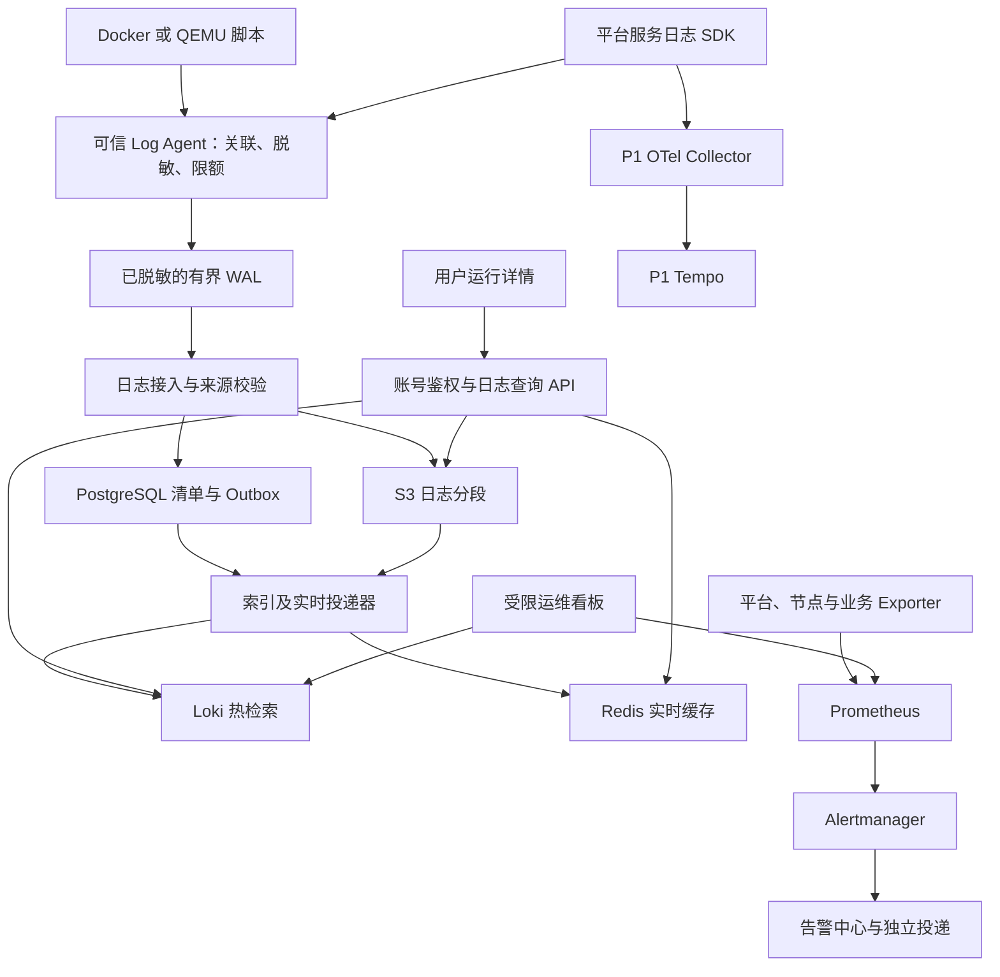

# Script Tools 部署运维与监控手册

版本：V3.0 / 2026-11-14。状态：基础工程实现中，前后端已有本地启动入口，生产部署与业务运行验收待完成。

本文维护部署、配置、节点运维、日志采集、指标、告警、容量、保留清理和排障。日志/SSE 字段与 API 见接口规范，数据库表见架构，测试步骤和结果见验收文档。

2026-11-15按用户决定，真实Runner与Docker/KVM/显式TCG调度在最后一个开发阶段接入，三模式采集、出站许可、租约、节点恢复及回收随该阶段完成。此前推进前端和业务控制面、资金、产物通知与独立景点适配，最终联调后执行生产验收，顺序见[详细开发设计](./06-详细开发设计.md#dev-delivery)。

[文档导航](./README.md) · [详细开发设计](./06-详细开发设计.md#dev-operations) · [完整数据库设计](./07-完整系统数据库设计.md)

- [1. 部署拓扑、发布与升级](#deployment)
- [2. 配置与版本基线](#configuration)
- [3. 观测目标、组件和数据流](#logging)
- [4. 可信采集与三模式接入](#collection)
- [5. 脱敏、预算与暴露控制](#redaction)
- [6. 归档提交、重放与降级](#log-durability)
- [7. 指标字典、统计口径与基数](#metrics)
- [8. 执行阶段耗时与时钟](#timing)
- [9. 全链路关联与追踪](#tracing)
- [10. 告警规则与处置闭环](#alerts)
- [11. 保留、删除、审计与备份恢复](#retention)
- [12. 容量、扩容与资源计量](#capacity)
- [13. 自监控与排障手册](#runbooks)
- [14. 支付、履约、退款和结算运维](#commerce-operations)

<a id="deployment"></a>

## 1. 部署拓扑、发布与升级

### 1.1 首期部署拓扑

- Web入口：React + TypeScript + Vite + Ant Design构建的静态前端，覆盖四工作区，由静态资源服务或CDN与认证/API网关共同提供；发布要求见[前端构建与部署](#frontend-deployment)。
- 控制节点：API、Scheduler、Dispatcher、Outbox Relay、Notifier、Reconciler，可按独立进程部署。
- 数据服务：PostgreSQL、Redis、对象存储、镜像仓库和独立密钥管理。
- 执行节点：Runner、Docker Engine、固定 QEMU 包装镜像及客户机镜像；按能力标记 Docker/KVM/TCG 容量。
- 网络出口：HTTP Broker、兼容代理与执行区防火墙。
- 监控服务：日志接入与查询、Loki、Prometheus、Alertmanager、Grafana；节点安装独立 Log Agent，P1 增加 OTel Collector/Tempo 追踪存储。监控缓存与任务队列使用独立 Redis 实例，避免日志挤占调度容量。

开发环境可使用 Compose；公开运行时控制服务与不可信代码执行主机分离。Kubernetes 不是首期前提。QEMU 先采用与 vm2api 类似的 Docker 包装管理，不把 libvirt 作为额外必选依赖。

### 1.2 发布与升级

控制 API 与 Runner 协议版本兼容检查；升级节点先排空，再替换镜像和运行时。基础客户机和依赖镜像按摘要发布，回滚回到已验证版本。已开始的 Attempt 固定其镜像与脚本版本。

预热仅启动无用户数据的干净环境。注入凭据后环境归属固定，结束后销毁；不得以删除几个文件代替执行环境销毁后重新创建。

协议兼容矩阵、精确镜像/组件版本、节点身份、租约和出口期限、限额、超时、通知回执、存储及保留配置必须纳入部署清单；初始 heartbeat=10s、lease=30s，出口许可不得晚于租约。版本仍须以实施验证结果固定，不宣称已有实测版本。部署先 expand 迁移，再兼容发布、节点排空、三模式示例及故障演练，见[节点、Guest Agent 与配置契约](./03-接口协议.md#agent)。

<a id="role-operations"></a>

### 1.3 商业化角色与能力发布

部署四工作区：游客、消费者、脚本发布者、平台管理员。发布者为有效个人账号自助进入的工作区，不设置人工入驻或上架审批。首名ADMIN+access.manage受控引导，后续按后台能力授权，最后权限管理员保护与账号冻结/注销共用事务守卫；当前无已实现管理CLI，不声称引导已完成。

付费售卖开放前必须完成支付适配器沙箱验签/金额校验、重复乱序回调、退款、打款、对账及恢复验证，并配置有效价格、平台费和结算窗口。商业模块是P0；能力未就绪时可运行自用测试，禁止向真实用户收费。门票首期以免费预约场景为主，服务费与0元票款分别显示，不部署门票代付或订阅续费入口。

角色撤权使管理订阅、数据访问会话及下载即时复核；data.diagnose使用限时精确范围凭证和逐次审计，不设双人批准流。私密正文和原始凭据不进入销售报表。发布者冻结/部署下线先停止新售卖，列出已购权益与在途订单并执行受控履约/补偿，不能只隐藏菜单。

### 1.4 页面、权限与分期检查

部署菜单和接口采用同版角色清单；测试直达路由、直接API、支付回调、下载和SSE。私人自用必须核对脚本owner，消费者不得借自用接口跳过付费。付费商品停销仍保留订单、退款和结算查询；场景关闭仍保留外部未知核验。恢复演练只登记计划与证据，生产恢复通过受控手册执行，不提供任意shell或一键覆盖生产。

<a id="frontend-deployment"></a>

### 1.5 前端构建、发布与回滚

前端采用已确认的React + TypeScript + Vite + Ant Design；动态表单RJSF仍在原型验证阶段。构建环境固定Node、包管理器与依赖锁，使用锁文件安装，执行独立TypeScript类型检查、相关测试及Vite生产构建。构建成功不能代替类型检查或Schema兼容验收；依赖版本与制品摘要纳入发布记录。

生产部署Vite构建产物，开发服务器及`vite preview`只用于开发或本地检查，不作为生产服务。网关支持页面深层路由刷新；SPA回退不得吞掉API、SSE、下载或缺失静态资源的错误。带内容摘要的资源可长期缓存，HTML入口需及时更新；发布保留兼容旧页面的资源窗口，回滚固定前端制品并核对API兼容，不能重写脚本Schema或任务版本。[Vite部署说明](https://vite.dev/guide/static-deploy.html)

前端构建变量、运行时公开配置和下载到浏览器的资源均视为公开信息。`VITE_*`仅保存公开API地址、版本等配置，不包含支付签名密钥、平台凭据或用户脚本秘密；敏感数据仍通过鉴权API按需取得，不写入静态包、公开source map或第三方前端错误报告。[Vite环境变量说明](https://vite.dev/guide/env-and-mode)

生产CSP、鉴权和网络策略下验证RJSF/Ajv及JSON编辑器；需要动态编译的候选方案不得以关闭CSP作为验收结论。若采用预编译校验，编译服务必须可信且受预算限制，产物绑定已校验Schema摘要并受控发布。JSON回退仍需可用的同方言校验路径，校验不可用时阻止执行提交。明确组件版本、已验证渲染范围和回退提示，按[FE专项用例](./05-测试验收与验证记录.md#frontend-tests)留存证据。

<a id="local-development"></a>

### 1.6 当前本地开发入口

在项目根目录执行以下命令。

```text
npm ci
npm run dev
```

前端地址为`http://127.0.0.1:5174/`，API为`http://127.0.0.1:3001/api/v1`，接口文档为`http://127.0.0.1:3001/api/docs`。5173端口已有其他项目占用，因此本项目采用5174。启动器先同步角色目录和SQL迁移，再启动TypeScript编译监听、NestJS API与Vite。

`npm run build`构建前后端，`npm run typecheck`执行类型检查。`node scripts/verify-foundation.mjs`验证当前实现页的浏览器交互、登录权限和截图，要求本地服务已启动。`node scripts/report-implementation.mjs`生成75个角色页面交付项的进度清单。

根目录`.env.example`提供配置模板。可复制为`.env`后填写`DATABASE_URL`连接PostgreSQL，空值采用`.local/database`内的PGlite持久化库。SQL迁移从07的15段DDL提取，启动时校验迁移摘要，已执行迁移的内容变化需要增量迁移。PGlite包含的PostgreSQL引擎与目标服务器版本分别验证。

2026-11-14本机已配置PostgreSQL 18.7，Windows服务名为`postgres_18`，监听`127.0.0.1:5432`。应用连接独立的`travel_tools`数据库，使用非超级用户`travel_tools_dev`；连接信息保存在根目录`.env`并已加入忽略规则。原PGlite目录继续保留。`node scripts/verify-postgresql.mjs`检查迁移摘要、145张表、1755个字段、事务提交回滚和双连接隔离及更新。该开发数据库已验证，生产部署与完整业务并发继续按验收矩阵执行。

`npm run dev`默认启用`DEV_SEED=true`，创建本地示例消费者、发布者和管理员，登录页提供示例账号填充按钮，示例密码为`TravelTools2026!`。这些账号和页面示例数据用于本地开发。设置`DEV_SEED=false`可关闭种子初始化。真实支付、运行执行、产物存储和通知模块仍在接入，页面级还原完成情况记录在`output/verification/frontend-implementation-progress.json`。

示例管理员具有`runtime.observe`日志只读能力，管理操作分别校验对应能力。既有开发种子授权仅在来源为`Local development seed`、账号匹配且授权有效时补入该能力，重复启动保持幂等。

登录页采用邮箱和密码，2026-11-14经用户确认以06接口契约为准。本地注册、邮箱验证和密码重设已接入数据库。启用`DEV_SEED=true`且`NODE_ENV`为开发环境时，验证受理响应带`development_token`，页面提供开发令牌填入入口。正式邮件服务继续接入，生产模式返回`AUTH_DELIVERY_UNAVAILABLE`。

开发认证挑战有效期10分钟，错误尝试预算5次，同账号每小时最多生成10份挑战，认证挑战入口每客户端每分钟最多60次。会话最长12小时，空闲窗口30分钟。注册待验证密码摘要及条款版本通过AES-256-GCM写入`private_payloads`，密钥位于忽略目录内的`.local/auth-development.key`，开发库恢复时需一并恢复该密钥。验证成功会擦除已消费注册正文。`node scripts/verify-identity.mjs`使用合成邮箱账号验证实际数据库和页面链路。

`node scripts/verify-retail.mjs`复核公开目录投影、游客与消费者市场及详情、购买回跳、可售状态和整数金额。数据库用例在事务中回滚，八卡片布局使用浏览器响应夹具。`node scripts/verify-production.mjs`通过本机临时预览端口检查Vite压缩产物，结束后关闭该端口。既有开发服务继续使用5174和3001。

数据库驱动为每条PostgreSQL池连接固定search_path=travel,public，PGlite在已有库打开时也设置相同路径，确保跨表触发器引用一致。`node scripts/verify-consumer-overview.mjs`复核本人概况、连续Run和批次产物可见性、首页与确认订单、Schema变化恢复及模式边界。概况默认最近30天，当前状态统计独立于历史窗口，首页live模式每30秒刷新，异常提供重试入口。开发模式的示例记录有页面标记，实际订单、任务及产物详情接口继续按对应契约接入。

发布者开通及设置使用本人资料接口，登录会话在开通后刷新工作区权限。命令回执采用AES-256-GCM和HMAC，开发环境复用`.local/auth-development.key`。设置`PAYLOAD_ENCRYPTION_KEY`可使用Base64编码的32字节密钥；开发种子关闭或生产环境时需配置该项，否则资料命令返回503。密钥仅在服务端使用，修改后重启API。生产密钥版本轮换和KMS继续按目标架构实施。该配置用于账号、发布者命令回执及私有脚本源码，其他私有正文继续按各自模块接入。

`node scripts/verify-publisher-profile.mjs`通过临时PGlite API与生产构建前端验证开通、资料更新、角色及错误恢复，并在PostgreSQL回滚事务内复核触发器修订和故障原子性。可选首个参数指定环境文件，省略时读取当前目录.env。验证补充提交期间新增输入、资料读取失败的草稿保留、已保存后的身份读取失败、独立重试进入、返回消费者后的迟到响应、公开资料与收款预览并发合并、条款及收款弹窗历史恢复、令牌清理和390像素布局。临时服务使用自动分配端口，结束后关闭并清理独立临时库。开发认证密钥与现有开发库继续保留。既有商业预览回归对资料响应使用浏览器夹具，真实资料持久化由该专项验证。

产物元数据列表与详情读取已接入本人范围，分页游标签名复用服务端PAYLOAD_ENCRYPTION_KEY或现有本地开发密钥，空列表无需签发游标。更换密钥后旧游标失效，客户端从首项重新查询。`node scripts/verify-outputs.mjs`验证C12、C13布局和选中项、预览下载、live元数据及失败恢复；数据库归属和游标回归并入`verify-consumer-overview.mjs`，合成记录在事务中回滚。正文、下载对象、实际通知和人工接续继续按原设计接入。

账号资料及会话接口已接入当前基础工程，昵称修改与会话撤销使用同一加密命令回执能力。登录、bootstrap及me的security_revision统一为十进制字符串，前端和接入方按字符串读取。GET me展示本人掩码邮箱、偏好、当前设备及最后永久权限管理员标识；注销检查和邮箱双向验证继续接入。`node scripts/verify-account.mjs`在临时API和生产构建前端中验证资料修订、回放、会话撤销、冲突恢复、提交期间继续编辑、资料读取失败、迟到身份响应、URL及历史恢复和三种C21桌面及390像素布局，临时库结束后清理；PostgreSQL专项在回滚事务内验证真实触发器及BIGINT精度。

`node scripts/verify-notifications.mjs`使用临时Vite预览端口与既有API登录，复核C16/C17布局、底栏遮挡、消息筛选和关联跳转、示例已读计数、偏好保存及live模式边界。示例阅读状态和通知偏好在当前前端会话内供导航验证，完整刷新后恢复初始示例，URL分类与未读条件继续保留。真实通知、收件渠道、验证和订阅持久化按03及06继续接入，live模式相应入口显示待接入状态。

Git检出按.gitattributes统一为LF。文档迁移摘要校验接受LF与CRLF的等价文本，继续使用原历史摘要及已登记的标题更名摘要，其他字节变更仍使校验失败。提交快照验证覆盖LF检出和修改正文后的拒绝结果。

<a id="configuration"></a>

## 2. 配置与版本基线

| 配置组 | 必须配置/登记的值 | 初始规则 |
| --- | --- | --- |
| 协议 | manifest/invocation/result/event、Runner、Agent、SDK 兼容版本矩阵 | 未知主版本拒绝；发布清单固定摘要 |
| 身份 | API 密钥来源、节点 CA、证书期限/轮换、允许受众、bootstrap 有效期 | 不将真实密钥写入代码包、日志或文档 |
| 租约 | heartbeat_seconds、lease_seconds、egress_grant_seconds、clock_skew_limit | 初值 10/30；出站期限不得晚于租约；严格时间偏差阈值需压测 |
| 限额 | 用户/模式/节点并发、CPU/内存/磁盘、请求和日志预算 | TCG 单独配额；拒绝无限预算 |
| 超时 | 准备、动作、Hook、停止、清理、核验、人工期限 | Hook/清理不能延长业务出站期限 |
| 存储 | DB、队列、对象桶、镜像仓库、Loki、密钥版本、保留/删除策略 | 业务队列与监控缓存隔离；禁止公开结果桶 |
| 通知 | 站内通道、邮件服务、限流、回执能力、独立运维备用通道 | 发送前复查订阅及账号状态 |
| 构建 | Python/Node、SDK、依赖锁、Docker/QEMU/Guest 镜像、数据库/监控组件版本 | 使用验证后的精确版本/摘要；当前不虚构已测试版本号 |
| 前端 | React/React DOM、TypeScript、Vite、Ant Design及候选RJSF/Ajv版本，构建Node/包管理器、依赖锁、制品摘要、公开API地址、CSP与缓存策略 | 四工作区采用确认栈；记录RJSF验证状态和Schema覆盖/回退清单，未验证不宣称兼容 |

部署步骤：迁移前备份与检查 → expand 迁移 → API/消费者兼容部署 → 节点排空并滚动升级 → 两种不同业务示例在三模式验证 → 独立探针与故障演练 → 开放调度。readiness 区分数据库可写、策略可用、出口可控、节点能力；单纯进程存活不代表可领取任务。

<a id="logging"></a>

## 3. 观测目标、组件和数据流

用户应能知道任务何时执行、使用什么模式、为什么没有结果、是否需要人工处理，以及提醒有没有发出。管理员应能判断问题位于调度、执行环境、脚本、景点接口、订单核验、通知还是监控系统自身，并追溯处理过程。

| 数据类型 | 解决的问题 | 事实来源与限制 |
| --- | --- | --- |
| 业务事件 | 任务和预约发生了什么 | PostgreSQL 状态及 Outbox；不从日志关键词推断 |
| 执行日志 | 脚本和运行环境如何运行 | stdout/stderr、Guest Agent、Runner；脚本内容视为不可信 |
| 服务日志 | 平台组件为什么出错 | 平台结构化 SDK、受控异常处理 |
| 审计记录 | 谁在何时进行了什么关键操作 | 服务端鉴权及事务记录，不依赖采样日志 |
| 指标 Metrics | 故障规模、趋势、容量和延迟 | 可信计数、业务聚合、宿主资源采集 |
| 链路追踪 Traces | 一次平台请求在哪个阶段耗时 | 平台分配上下文，P1 存储到 Tempo；不作为订单唯一证据 |
| 运维告警 | 哪种异常需要什么人处理 | 规则计算及受控事件，不直接驱动预约重放 |

“无票”属于成功查询的一种业务结果；“有票”不等于预约成功；“脚本退出成功”不等于订单核验通过。库存通知、订单通知与运维告警采用独立事件类型、队列优先级和接收规则。

To C 权限采用本人数据校验：普通用户只能访问自己的日志、任务统计和导出。平台管理权限独立授予，不设置组织、成员、空间切换或租户配置。

### 3.1 建议选型

| 组件 | 选择 | 职责 | 阶段 |
| --- | --- | --- | --- |
| 结构化日志 SDK | 平台统一 SDK，字段映射 OpenTelemetry | 生成关联 ID、模板日志、脱敏和错误分类 | P0 |
| 执行采集器 | 独立可信 Log Agent | Docker 输出、QEMU 外层诊断、客户机输出，脱敏及有界 WAL | P0 |
| 日志接入服务 | 控制代码库的独立进程 | 来源验证、分段提交、持久化确认、索引与实时投递 | P0 |
| 业务与清单存储 | PostgreSQL | 审计、业务事件、归档清单、告警处置和导出任务 | P0 |
| 日志归档 | S3 兼容存储，压缩 JSONL | 普通日志的可重放归档、下载源 | P0 |
| 热检索 | Loki | 最近 7 天的搜索副本，不能充当业务事实源 | P0 |
| 实时缓存 | 独立 Redis Streams | 短期订阅与断线续读；可从归档补偿 | P0 |
| 指标 | Prometheus、Node Exporter、平台 Exporter | 服务、节点、执行方式、业务及监控自身指标 | P0 |
| 告警 | Alertmanager + 平台告警中心 | 聚合、路由、静默和恢复通知；平台记录处置历史 | P0 |
| 运维图表 | Grafana | 管理员看板，数据源账号限制权限 | P0 |
| 分布式追踪 | OpenTelemetry Collector + Tempo | 跨组件 Span、采样、追踪检索 | P1 |

首期不强制 Kubernetes、Kafka 或 Elasticsearch。日志归档接入和权限查询需要本项目实现，不能认为安装 Loki 后就自动获得业务权限、可靠归档和用户页面。组件版本须固定，部署前核对兼容性、资源与许可证。

### 3.2 数据流



图中业务事件与审计另走数据库事务，不经过脚本 stdout。监控服务、业务存储和执行节点按资源与访问权限分开；日志 Redis 不与任务队列共用内存预算。

### 3.3 内部服务访问

Loki 配置 `auth_enabled: false`，使用平台内部统一存储空间，不为每个用户建立 Loki 身份。该参数关闭的是 Loki 的多租户模式，不能替代认证。Loki 只允许日志接入、查询服务和受限 Grafana 访问，通过私网与认证网关保护，公网客户端不得直连。[Loki 模式说明](https://grafana.com/docs/loki/latest/operations/multi-tenancy/)、[认证说明](https://grafana.com/docs/loki/latest/operations/authentication/)

Prometheus、Alertmanager、Tempo 和 Exporter 同样不直接开放给普通用户。数据源凭据只保存在服务端；用户不提交原始 LogQL/PromQL，也不能使用管理看板的数据源代理绕过业务 API。

<a id="collection"></a>

## 4. 可信采集与三模式接入

接入服务以节点身份、任务令牌、有效采集授权与服务端保存的 Attempt 映射验证归属。旧 Attempt 允许在短期日志补传授权内补传，但该授权没有预约提交能力。脚本输出的 `owner_user_id`、`VERIFIED`、`event_name` 或 `trace_id` 不覆盖外层元数据，不产生平台审计事件或订单确认。

私有日志缺少归属时进入受限隔离队列并报警，不能默认全员可见。`visibility=USER` 同时要求归属匹配；公共脚本作者不能查看使用者的参数或运行记录。管理员查看用户日志须具备排障权限，记录操作者、事由、查询范围及导出行为。

Hook 调用区分平台派发、平台接受结果与 SDK 观测的 `hook.started/completed/failed`。派发及接受记录来自控制服务；SDK 处于脚本执行环境，其生命周期消息按 SCRIPT 可信程度保存，不能证明业务副作用已经发生或被阻止。平台根据派发记录验证 Invocation 属于当前 Attempt，未知或伪造关联仅保留为受限脚本内容。运行详情分别展示主动作结果、附加 Hook 错误、超时和清理状态，不能用 `after_action` 失败覆盖已确认订单。

自定义动作名及事件名可由发布者新增，统一放在经过长度限制的 action_name 或 attributes.script_event_name 字段，按版本清单核验。它们不覆盖平台 event_name、可信状态或告警规则；原始事件 data 与结果 data 不默认复制进日志、Trace 或告警。用户按脚本和动作检索时先校验归属，再使用结构化字段查询。

### 4.1 序列、关联与缺口

同一源按 `(source_instance_id, source_seq)` 排序；重复记录按 `event_id` 去重。跨服务日志按可信 `observed_at` 与事件 ID 稳定展示，不承诺全局因果顺序。业务阶段顺序以事务事件版本为准，耗时尽量使用同进程单调时钟。

采集连接重建生成新会话并记录缺口起止或“丢失范围未知”。已知丢弃数量与未知丢失区间分别表示，不能伪造精确丢失条数。脚本自带时间异常仅显示为来源时间偏差，不能污染可信调度延迟指标。

### 4.2 Docker 任务容器

建议任务容器使用 `log-driver=none`，独立 Log Agent 通过 Docker Engine attach 流接收 stdout/stderr，关闭 TTY 与 stdin，不转发采集器信号。受控启动入口先待命，采集连接就绪后才释放脚本执行；入口等待不能包含用户凭据打印。该启动握手需要在选定 Engine 版本验证，不能仅靠“先启动后读取日志”保证第一行被捕获。

Log Agent 与 Runner 生命周期分开，Runner 重启不应主动关闭采集。采集器先持续排空管道，再通过有界队列做规范化、脱敏和写盘；大输出超限时丢弃并计数，不能在上传存储时同步阻塞管道。attach 本身存在缓冲及背压，需通过洪泛和断线测试验证；采集彻底断开期间不承诺无阻塞或零丢失。[Docker attach](https://docs.docker.com/reference/cli/docker/container/attach/)

默认 Docker `json-file` 可能先将原始输出写入宿主磁盘，之后的中央脱敏无法消除这份原始副本。因此不能直接把默认日志驱动作为敏感脚本日志的采集方案。`none` 模式不提供 `docker logs` 历史回读；断线丢失必须显式呈现。可信控制服务可使用已在 SDK 脱敏且有轮转上限的 `local` 日志驱动。[Docker 日志驱动](https://docs.docker.com/engine/logging/configure/)

任务内的文件日志不默认扫描整个工作目录。需要接入时，由 Manifest 声明受限日志路径与格式，采集拒绝符号链接和路径越界；默认仅内存目录，读取后仍脱敏。禁止自动打包整个工作目录作为诊断附件。

### 4.3 QEMU+KVM 与 QEMU+TCG

| 层次 | 采集方法 | 注意事项 |
| --- | --- | --- |
| 外层 Docker / QEMU | 与任务容器相同的受控流式采集 | 记录 QEMU 启动、退出和加速器结果，不持久化未经处理的 console 文件 |
| QMP | Runner 读取必要事件并输出模板日志 | QMP socket 不开放给脚本，不记录完整命令或敏感参数 |
| Guest Agent | 捕获脚本输出，经任务专属认证通道上传 | 带会话和序号，宿主再次验证归属与脱敏 |
| 客户机资源 | Agent 上报可选诊断指标 | 客户机可能受脚本影响，仅作辅助；限制以宿主 cgroup 为准 |
| 系统诊断 | 启动错误、Agent 失联、退出码和受限错误摘要 | 禁止自动上传内存转储、磁盘镜像或含凭据的启动材料 |

Guest Agent 使用有界内存缓冲；如确需持久化补传，只保存已脱敏数据并采用独立配额。宿主确认已写入自身 WAL 后，Guest Agent 才释放相应记录。连接重试带原始事件 ID；客户机被销毁前无法补传的数据记录为缺口。

三种方式共用查询协议和字段，但 `actual_execution_mode` 必须真实。QEMU 外层 cgroup 覆盖客户机、QEMU 进程等总开销；客户机内存数字是其中的视图，不能与外层内存再次相加。TCG 单独设置容量、启动耗时和 CPU 告警基线。

### 4.4 构建与平台组件

依赖安装同样可能运行用户代码，构建日志按不可信来源采集和限额。构建凭据只授予必要的镜像和制品访问，不注入旅游账号。平台 SDK 使用结构化模板，默认不记录异常对象全部属性、环境变量或 HTTP 客户端完整配置。

<a id="redaction"></a>

## 5. 脱敏、预算与暴露控制

### 5.1 处理顺序

原始流只经过有界内存 → UTF-8/控制字符处理 → 字段允许列表 → 已知敏感字段及模式遮盖 → 长度限制 → 可信元数据封装 → 本地 WAL → 中央存储。查询与导出再执行当前脱敏策略，防止历史规则遗漏继续展示；不能只在前端打码。

| 内容 | 默认处理 |
| --- | --- |
| Authorization、Cookie、Set-Cookie、session、token、密码、签名密钥 | 删除字段值或固定 `[REDACTED]`，不留可重放片段 |
| 身份证件、手机号、实名、邮箱、订单凭据 | 优先不记录；必要字段按允许规则掩码 |
| URL | 保存端点模板或连接器动作，删除查询参数和片段 |
| 请求体、响应体 | 默认禁用；只提取受控错误码、状态和大小 |
| 关联敏感实体 | 使用业务对象 ID；需稳定比对时使用服务端带密钥摘要，禁止直接散列低熵证件号 |
| 异常栈 | 截取必要帧，清理参数、路径敏感片段与第三方返回正文 |
| Trace / 指标 / 告警 | 不携带凭据、完整 URL、个人资料或原始异常文本 |
| 前端渲染 / 导出 | 纯文本转义，去除危险控制序列；默认 JSONL/TXT，避免表格公式执行 |

分块读取需处理敏感字段跨 chunk、跨行和超长单行的情况，维护有界匹配缓冲；无法安全解析的已知敏感记录整条替换。脱敏规则采用版本管理、合成样本测试和灰度发布。测试覆盖原文、常见 URL 编码、JSON 转义与异常栈，但不声称能识别任意恶意编码；尽量由 Broker 保管凭据，减少脚本能够输出的敏感材料。

各脚本业务输入以发布者 JSON Schema 为准，字段名和结构不固定。平台不自动把完整 `input` 写入日志、Trace、告警或参数摘要；参数校验失败只记录脚本版本、Schema 摘要、受长度限制且脱敏的字段路径、规则与错误类别，不记录被拒绝的原始值。动态参数表单和校验页面按本人权限读取配置，不能因使用共享脚本而向发布者开放用户参数。

### 5.2 初始配额

| 对象 | 建议值 | 超限行为 |
| --- | --- | --- |
| 单条消息 | 16 KiB，扩展属性最多 32 项 | 截断并记录原因；超长原文不另存 |
| 单 Attempt 普通日志 | 10 MiB，与资源模板一致 | 继续排空输出，停止保存超额正文，保留截断事件和计数 |
| 单构建日志 | 20 MiB | 同上；不得挤占运行日志预算 |
| 单用户每日日志写入 | 100 MiB 起评估 | 先提示，限额策略由平台统一管理，可信业务事件仍写数据库 |
| 节点脱敏 WAL | 2 GiB 或 24 小时，先达者生效 | 分来源公平限额，优先丢弃低等级普通日志并报警 |
| 实时缓存 | 每 Run 最多 10,000 条，TTL 1 小时 | 超出从归档续读或返回缺口；独立实例还有全局内存上限 |
| 单次页面查询 | 最多 500 条、24 小时时间窗 | 分页或缩小范围，不能无限扫描 |
| 单次导出 | 100 MiB、总并发 2 个/用户 | 异步排队或拒绝，给出原因 |

脚本自报 ERROR 不允许绕过日志总额；关键审计使用独立数据库通道。自动因日志超限终止脚本仅作为显式策略，默认丢弃超额日志并继续业务流程，避免日志输出改变在途预约状态。

<a id="log-durability"></a>

## 6. 归档提交、重放与降级

### 6.1 归档提交协议

1. 可信采集端分配 `event_id`，脱敏后写本地 WAL；写入成功才进入待上传集合。
2. 按归属、Run 或构建、来源会话分组，批次达到 1 秒或 256 KiB 时封成不可变分段。分段 ID、内容摘要和事件 ID 在重试时不变。
3. 接入服务验证采集身份、授权范围、大小和序号，写入私有 S3 分段对象。
4. 对象写入成功后，数据库事务写 `log_segments` 清单和索引/实时投递 Outbox；分段 ID 唯一，同 ID 不同摘要拒绝并报警。
5. 接入服务在上述提交完成后返回归档 ACK；采集端再释放对应 WAL 记录。普通接收 ACK、HTTP 连接成功或 Collector 内存入队都不等于归档 ACK。
6. 索引消费者从归档生成 Loki 记录和实时缓存，按稳定 ID 去重。两路独立记录进度，失败重试不阻止已经完成的归档确认。

S3 成功、清单事务失败时，采集端保留分段并重试；后台扫描无清单对象，经过安全宽限期后清理孤儿。清单已提交但 ACK 丢失时，重复提交返回原确认。只有缺少对象或校验失败的清单才进入修复队列，不能静默跳过。

分段有独立 `archive_status`、`index_status` 和 `live_status`，不把“已归档”误显示为“实时索引已完成”。迟到且超出 Loki 可接收时间范围的记录仅进入归档，查询界面提示可查询路径。Loki 重建只覆盖热保留期内有效数据，并应用删除标记。

### 6.2 有界可靠性

这是带持久化与去重的至少一次传递设计，不承诺网络分区、节点磁盘损坏、采集断线时零丢失。节点 WAL 仅在该磁盘存活且未超限时可恢复；未被采集的 stdout 无法从 WAL 恢复。没有已知缺口也只能表示“未检测到缺口”，不能作为绝对完整证明。

P1 OTel Collector 的持久化发送队列可缓解重启丢失，但队列满、磁盘失败或重试期限结束仍可能丢数据。它主要承担追踪传输，不替代上述日志归档确认协议。[OTel Collector 弹性设计](https://opentelemetry.io/docs/collector/resiliency/)

### 6.3 降级矩阵

| 故障 | 行为 | 恢复与提示 |
| --- | --- | --- |
| Loki 不可用 | 继续归档，实时和业务状态独立运行 | 查询切到受限归档任务，索引恢复后补建 |
| 实时 Redis 不可用 | 不影响归档与业务 | SSE 提示延迟，改为有限轮询和归档续读 |
| 中央接入 / S3 不可用 | 采集端 WAL 有界积压 | 队列接近上限告警，超限记录丢弃及缺口 |
| Log Agent 重启 | 重放已写 WAL，重连运行环境 | 标记断连时间；不声称恢复断连期间原始输出 |
| 节点磁盘满 | 持续排空并丢弃普通日志，保留小型应急计数；节点停止接新任务 | 节点隔离与清理，不通过无限重试耗尽内存 |
| 日志数据库清单写入失败 | 不发归档 ACK，重试保持原分段 ID | 业务数据库压力隔离；超过预算明确降级 |
| 关键预约审计无法持久化 | Broker 停止授予新提交许可 | 已可能提交的操作保留未知并优先对账，不因观测故障重复提交 |
| Prometheus / Alertmanager 不可用 | 业务继续；独立存活探针走备用运维渠道 | 看板显示采集时间和不可用，不显示为零故障 |

一般日志服务故障不阻断订单查询和对账。关键授权、提交许可、订单状态与 Outbox 在业务事务中保存，不能因普通日志积压降级为不留关键记录的提交。

<a id="metrics"></a>

## 7. 指标字典、统计口径与基数

### 7.1 指标字典

以下是拟实现指标，名称不代表第三方组件已经提供。单位使用秒、字节和计数；Histogram 分桶应覆盖目标延迟，标签仅使用受控枚举。[Prometheus 命名建议](https://prometheus.io/docs/practices/naming/)

| 指标 | 类型 | 有限维度 | 用途 |
| --- | --- | --- | --- |
| `tt_api_requests_total` | Counter | service、route_template、method、status_class | 平台 API 错误率与流量 |
| `tt_api_request_duration_seconds` | Histogram | service、route_template | API P95/P99 |
| `tt_scheduler_enqueue_delay_seconds` | Histogram | trigger_kind | 计划时间到入队时间；触发类型为有限枚举，不使用发布者分类 |
| `tt_queue_oldest_age_seconds` | Gauge | execution_mode、trigger_kind | 最老可执行排队实例的等待时间 |
| `tt_attempt_prepare_duration_seconds` | Histogram | actual_execution_mode、outcome | 环境准备性能 |
| `tt_scheduled_first_request_delay_seconds` | Histogram | actual_execution_mode、connector_kind | 指定时刻首个受控请求偏差 |
| `tt_attempts_total` | Counter | actual_execution_mode、terminal_status、reason_class | 尝试结果；不等于订单结果 |
| `tt_hook_invocations_total` | Counter | action_kind、actual_execution_mode、result_class | action_kind 仅 custom/extension；不把任意动作名作为标签，统计平台调用结果 |
| `tt_hook_invocation_duration_seconds` | Histogram | action_kind、actual_execution_mode | 平台派发至接受结果或超时的耗时，包含外围 Hook |
| `tt_http_requests_total` | Counter | method_class、result_class | 通用网关请求结果与拒绝，不以原始域名/URL/动作名生成标签 |
| `tt_custom_events_total` | Counter | result_class | 自定义事件接受/拒绝统计，不使用发布者事件名标签 |
| `tt_unknown_side_effect_oldest_age_seconds` | Gauge | action_kind | 未处理未知副作用的最老年龄，无业务核验器时仍能显示待处理状态 |
| `tt_pending_action_oldest_age_seconds` | Gauge | reason_class | OPEN 待处理项最老年龄，已过期和关闭分别计数 |
| `tt_task_hold_count` | Gauge | reason_class | 活跃逻辑阻塞数；用户/动作仅保留在结构化明细 |
| `tt_result_projection_lag_seconds` | Gauge | projection | 已接受结果到运行投影的延迟，不从脚本日志推断接受 |
| `tt_outbox_oldest_age_seconds` | Gauge | event_class | 未投递事件年龄；event_class 为平台有限集合 |
| `tt_quota_inconsistency_count` | Gauge | scope、execution_mode | 租约/预留/节点环境对账不一致，不直接盲目释放槽位 |
| `tt_data_deletion_oldest_age_seconds` | Gauge | store_class、step_status | 注销和删除逐存储积压；不包含用户 ID 标签 |
| `tt_runtime_fallback_total` | Counter | requested_mode、actual_mode、reason_class | KVM→TCG 回退 |
| `tt_runtime_slots` | Gauge | execution_mode、slot_state | 可用、占用与隔离容量 |
| `tt_runner_lease_expired_total` | Counter | execution_mode | 失效租约 |
| `tt_cleanup_pending_oldest_age_seconds` | Gauge | execution_mode | 残留资源清理积压 |
| `tt_runtime_cpu_seconds_total` | Counter | node、execution_mode | 按节点/模式聚合的实际 CPU 使用 |
| `tt_runtime_memory_bytes` | Gauge | node、execution_mode | 外层 cgroup 当前总内存 |
| `tt_broker_requests_total` | Counter | connector_kind、operation_class、result_class | 可选可信连接器统计，类别由平台限额管理，不复制任意发布者动作名 |
| `tt_inventory_observations_total` | Counter | channel_class、inventory_status、verification | 有效查询、无票、有票、未知 |
| `tt_booking_transitions_total` | Counter | state、verification | 预约状态变更，不按日志条数计数 |
| `tt_booking_unknown_count` | Gauge | channel_class | 数据库中当前未知操作数量 |
| `tt_booking_unknown_oldest_age_seconds` | Gauge | channel_class | 最久未决预约年龄 |
| `tt_notification_pending_oldest_age_seconds` | Gauge | delivery_channel、priority_class | 用户通知积压 |
| `tt_notification_first_attempt_delay_seconds` | Histogram | delivery_channel、event_class | 业务事件到首次投递尝试 |
| `tt_log_ingest_delay_seconds` | Histogram | source_kind | 可信观察到归档确认的时间 |
| `tt_log_index_lag_seconds` | Gauge | pipeline | 已归档到热索引的积压 |
| `tt_log_dropped_total` | Counter | source_kind、reason_class | 已知丢弃数，未知缺口另报事件 |
| `tt_log_wal_usage_ratio` | Gauge | node | 本地 WAL 使用比例 |
| `tt_log_source_connected` | Gauge | node、source_kind | 聚合采集连接健康，避免每 Attempt 生成序列 |
| `tt_log_canary_last_success_timestamp_seconds` | Gauge | pipeline | 独立探针在查询端查到最新合成记录的时间 |
| `tt_alert_delivery_failures_total` | Counter | receiver_class | 运维告警投递失败 |

补充采集 Node Exporter 的 CPU、可用内存、磁盘空间/inode、网络、时钟偏差；数据库连接/锁/复制延迟、Redis 内存/消费者积压、对象存储请求失败、Loki 写入/查询/Compactor、Prometheus 抓取和规则执行、Alertmanager 投递及 P1 Collector/Tempo 健康指标。第三方指标名称在固定版本的部署清单中锁定。

产物与持续运行指标：`tt_output_batches_total{phase,status,run_mode}`、`tt_output_bytes_total{kind,run_mode}`、`tt_output_validation_oldest_age_seconds{kind}`、`tt_output_dependency_wait_seconds{reason_class}`、`tt_output_orphan_count{store_class}`、`tt_continuous_runs{state,execution_mode}`、`tt_progress_age_seconds{run_mode}`、`tt_checkpoint_conflicts_total{run_mode}`、`tt_stop_duration_seconds{run_mode}`。统计从批次、上传、检查点与租约事实产生；文件名、原始 MIME、batch_key、游标、输出 ID 均不得作标签。节点心跳与业务进度分开。

接入诊断补充：按 import_id/adapter_digest 关联获取、构建、映射及试运行事件，这些 ID 只作为鉴权检索字段，不作为指标标签。新增 tt_execution_phase_seconds{phase,execution_mode,run_mode}（Histogram）与 tt_adapter_failures_total{stage,reason_class}（Counter），phase/stage/reason_class 为平台固定集合。映射仅记录变量名/文件目标、字段路径与错误类别，不记录实际 argv、环境值或凭据。

可信阶段时间及口径见[产品需求与功能设计](./01-产品需求与功能设计.md#tasks)：分别展示排队、准备、就绪等待、动作执行和清理；跨节点时钟异常标记无效。只对已结束阶段统计完整耗时；长时间运行另显示当前驻留时长。连接建立不替代 HTTP 首请求时间，平台结果接受不必晚于主进程退出。

### 7.2 统计规则

统一分离 Run 终态、Attempt 退出、结果接受、verification_status、effect_status、通知及清理。CLOSED_UNRESOLVED 单独计数，不纳入确定失败或成功；UNKNOWN 的已结案项仍纳入未解决效果统计，按 active/closed 有限维度展示。等待人工不占活跃计算配额，但有逻辑阻塞；残留环境计隔离容量。after_action 或通知失败不能重复增加业务失败数。消费者以事件 ID/修订去重，指标聚合任务定期与数据库事实对账。


- 平台可用率分母为合格的平台请求或合成探测，排除客户端主动取消等明确类别。景点无票不计平台错误；平台 5xx、超时和平台内部失败要计入。
- 有效库存查询分母为通过协议验证的观测，`UNKNOWN`、鉴权失败、网络失败单列。命中率是有效观测中 `AVAILABLE` 的比例，不能称为抢票成功率。
- 订单确认率必须标明观察窗口及同一批预约操作的分母；未决操作单列，不把当期全部确认数除以当期提交数造成跨窗口失真。
- 指定时间首请求延迟仅在可信 Broker 确认实际发起请求时记录。兼容 CONNECT 代理只能记录连接建立，不能替代 HTTP 请求发出时间。
- 未决订单、队列年龄、有效槽位等当前状态由数据库或控制端快照生成；状态事件计数按事件 ID 消费去重，不因 Outbox 重投累加。Exporter 重启的 Counter 重置由指标计算处理。
- 请求模式与实际模式分别记录；TCG 请求、KVM 不可用、回退成功不能合并为 KVM 成功。无有效样本显示“无数据”，不能显示为零延迟或 100% 成功。

### 7.3 基数与资源

发布者动作、事件、分类和请求目标数量不受固定业务枚举约束，禁止直接作为 Prometheus/Loki 索引标签。按脚本或动作的详细统计由鉴权业务查询完成。action_kind、trigger_kind、method_class 等统计类别由平台维护有限集合，不由脚本自由新增。

用户 ID、Run ID、Attempt ID、容器 ID、动态脚本版本、完整 URL、时间戳和自由错误文本不作指标标签。渠道通过受控目录设置上限，超出并入类别；节点属于有限基础设施维度并监测其序列增长。按用户或某次执行的资源明细写入有界数据库统计或日志，由账号权限控制查询。

容器指标采集器若默认暴露逐容器序列，写入 Prometheus 前必须聚合或丢弃这些动态标签。按当前槽位采集外层 cgroup 使用情况，累计 CPU 以生命周期增量汇总，不能把已退出容器清除导致计数倒退。QEMU 客户机资源只作辅助诊断，与宿主总量分栏展示。

<a id="timing"></a>

## 8. 执行阶段耗时与时钟

运行时间线分开记录 `scheduled_at`、`enqueued_at`、`preparation_started_at`、`environment_ready_at`、`action_started_at`、`process_exited_at`、`result_accepted_at`、`cleanup_finished_at`；持续执行尚未发生的时间为空。等待槽位、环境准备、就绪后等待、动作执行及收尾耗时各自统计，不能把总启动时间全部称为调度延迟。

同一受信任时钟内用单调计时；跨主机时间展示校时误差，出现时间倒序标记测量无效。主动作与结果接受可能先于进程退出，不能要求整列时间严格线性。`first_request_at` 只有 Broker 真正观测到 HTTP 发出时记录，兼容 CONNECT 连接时间单独显示；脚本自报不能用于平台 SLA。

<a id="tracing"></a>

## 9. 全链路关联与追踪

P0 即统一 `request_id/task_id/run_id/attempt_id/booking_operation_id/notification_id`，各服务之间使用可信上下文关联日志和业务事件。客户端传来的追踪标识先验证，不能用来决定用户身份；脚本自报标识不改变平台归属。

| 链路 | Span 建议 | 边界 |
| --- | --- | --- |
| 用户 API | 请求、鉴权、业务处理、数据库 | 路由模板，不保存请求正文 |
| 调度 | 创建 Run、分配、领取 | 跨队列记录链接，不持有覆盖数天的单个 Span |
| 执行 | 环境准备、脚本启动、清理 | 只包含可信阶段信息 |
| HTTP Broker | 策略验证、连接器请求、结果解析 | 第三方凭据和实名字段不写入 Span |
| 预约 | 提交许可、提交、后续核验 | 异步对账产生新 Trace，通过操作 ID 与 Span Link 关联 |
| 通知 | 事件接收、服务商投递 | 投递重试各自记录，关联同一通知 ID |

内部服务传播 trace context；向第三方景点默认不注入平台 Baggage 或额外 Trace Header，除非接口明确接受且经过策略允许。人工等待和长时间排队不使用无限长 Trace，继续运行时创建新 Trace 并关联原 Run。

P1 首期建议正常 Trace 固定比例采样，例如 10%，对受控预约路径采用单独预算策略。头部采样已丢弃的 Span 不能通过后续“错误全保留”恢复；若需要尾部采样，必须先接收完整候选 Span，同一 Trace 路由到一致的采样实例，并设置决策窗口、内存和磁盘预算。无论采样比例如何，关键审计与业务事件均完整进入业务数据库。

<a id="alerts"></a>

## 10. 告警规则与处置闭环

### 10.1 等级与处理目标

告警等级使用 S1/S2/S3，避免与需求优先级 P0/P1 混淆。以下为初始运维目标，需结合值班安排确认；不能把未安排人员的目标宣称为服务承诺。

| 等级 | 含义 | 建议响应 | 投递与升级 |
| --- | --- | --- | --- |
| S1 | 平台不可用、预约一致性或明显安全风险 | 5 分钟内确认 | 立即主通道；5 分钟未确认升级备用联系人/通道 |
| S2 | 功能受损、积压或容量将耗尽 | 15 分钟内确认 | 聚合通知；15 分钟未确认升级 |
| S3 | 趋势、容量优化和非紧急提醒 | 工作时间处理 | 站内告警中心或摘要 |

用户的有票提醒和预约待处理提示由业务通知策略发送，不受运维告警静默影响。备用告警通道不依赖同一个业务 Redis、Notifier 或单一邮件服务商。

### 10.2 初始规则目录

阈值为工程起点。比例规则同时设置最小样本，时间规则区分“业务年龄”与额外持续时间；无数据必须通过独立缺失规则处理。

| 编号 | 条件示例 | 持续时间 | 等级 | 首要动作 |
| --- | --- | --- | --- | --- |
| AL-01 | 平台 API 5xx 比例 >5%，5 分钟内请求 ≥100 | 2 分钟 | S1 | 检查发布、数据库和依赖，不归咎于景点无票 |
| AL-02 | 外部合成平台探测连续 3 次失败 | 30 秒周期 | S1 | 从独立探针确认入口、DNS 与控制服务 |
| AL-03 | 最老可执行 Run 排队 >60 秒且容量应可用 | 2 分钟 | S2 | 检查队列、领取与容量；窗口任务单独提高优先级 |
| AL-04 | 指定时间任务错过请求窗口 | 可信事件即时触发 | S2 | 通知受影响用户并定位时钟、预热、队列 |
| AL-05 | 节点心跳超过 30 秒且有在途任务 | 1 个评估周期 | S1 | 撤销新提交能力，核验已发请求并隔离节点 |
| AL-06 | 有 KVM 待运行任务但健康 KVM 容量为 0 | 2 分钟 | S2 | 检查 /dev/kvm 与节点；不能擅自启用 TCG |
| AL-07 | 未授权回退或实际模式与策略不符 | 可信事件即时触发 | S1 | 停止新分配，核查策略与执行器 |
| AL-08 | 已授权 KVM→TCG 回退 10 分钟内 ≥3 次 | 1 分钟 | S2 | 检查硬件能力和容量，不伪装为 KVM 正常 |
| AL-09 | 节点内存 >90% 或 CPU >90% | 5 分钟 | S2 | 按模式检查配额与扩容；TCG 单独基线 |
| AL-10 | 数据/WAL 磁盘可用 <15% 或 WAL 使用 >80% | 2 分钟 | S2 | 限制新任务，检查写入速率与保留 |
| AL-11 | 磁盘可用 <5%、WAL 无法写入或已丢弃日志 | 1 个评估周期 | S1/S2 | 是否影响业务持久化决定等级；暴露缺口 |
| AL-12 | 清理未完成的最老环境 >5 分钟 | 2 分钟 | S2 | 隔离槽位，核对容器、QEMU、磁盘和网络 |
| AL-13 | UNKNOWN 预约最老年龄 >120 秒 | 1 个评估周期 | S1 | 对账与人工处理；按渠道调整 SLA，不自动重提 |
| AL-14 | 渠道 429/鉴权错误比例 >20%，5 分钟 ≥50 请求 | 2 分钟 | S2 | 降低请求预算或提示更新凭据，不提高并发 |
| AL-15 | 高优先级用户通知最老等待 >30 秒 | 1 分钟 | S2 | 检查服务商与投递队列，订单状态不回滚 |
| AL-16 | 日志索引积压 >30 秒或归档确认延迟持续增大 | 2 分钟 | S2 | 查看存储与消费者，切换受限归档查询 |
| AL-17 | 每分钟合成日志超过 3 分钟未从查询端查到 | 1 个评估周期 | S2 | 端到端检查采集、归档、索引、鉴权和查询 |
| AL-18 | Prometheus 目标缺失、规则执行错误或告警投递连续失败 | 2 分钟 | S1/S2 | 独立探针和备用通道通知，避免自监控盲区 |
| AL-19 | 重复提交许可不变量被破坏、严重越权或出口策略被绕过 | 可信事件即时触发 | S1 | 停止受影响路径并审计，不泄露用户资料到通知 |
| AL-20 | 执行节点绝对时钟偏差 >200ms | 2 分钟 | S2 | 从严格放票任务池移除，校时后验证恢复 |
| AL-21 | 归档删除积压 >24 小时或 Compactor 停止 | 15 分钟 | S2 | 检查删除任务、存储权限与副本清理 |
| AL-22 | 通用自定义动作的未知副作用待处理超过已配置阈值 | 按动作风险策略 | S2 | 检查外部调用与已接受结果；无核验器转人工，不自动重跑 |
| AL-23 | 已接受结果超过 30 秒未形成预期运行投影，或 Outbox 最老年龄 >60 秒 | 2 分钟 | S2 | 回读结果回执和事务事件，修复投影/投递；禁止重跑业务 |
| AL-24 | 租约、配额预留与真实环境连续两次对账不一致 | 1 分钟扫描周期 | S2 | 撤权并隔离残留，按预留 ID 幂等释放；不直接复用目录 |
| AL-25 | 待处理项过期未转换、task_hold 与来源状态不一致，或注销/删除步骤超策略期限 | 2 分钟 | S2 | 修复有版本状态及清理任务；未知效果不能自动解除阻塞 |
| AL-26 | 产物验证/附件等待超策略期限，或连续批次缺少必需项 | 2 分钟 | S2 | 查批次、生成状态及附件依赖，修复传输/投递，不重跑主动作 |
| AL-27 | 上传孤儿/分片积压、输出预算异常或产物清理超期 | 2 分钟 | S2 | 查归属及预留，幂等回收；不恢复删除入口 |
| AL-28 | continuous 租约失败，或超过声明 idle_policy 的无业务进度时限 | 1 个评估周期 | S1/S2 | 区分节点失联和正常等待；撤权/告警，不盲目重启 |
| AL-29 | STOPPING 超宽限期、检查点冲突持续或恢复次数超限 | 1 个评估周期 | S2 | 停止重启循环，核验未决效果、检查批次与游标事务 |

AL-13 等预约专用规则只随旅行场景启用；AL-22 使用平台管理的有限规则与风险类别，不为每个发布者动作自动生成无限量告警规则。发布者事件不能自行指定运维告警级别或接收人。

### 10.3 规则示例

以下 Prometheus 规则使用本项目待实现的指标名，需在工程阶段执行 promtool 校验及规则用例测试，不是已经部署的配置：

```yaml
groups:
  - name: script-tools-core
    interval: 15s
    rules:
      - alert: ScriptToolsApiErrorRatioHigh
        expr: >-
          (sum(rate(tt_api_requests_total{status_class="5xx"}[5m]))
          / clamp_min(sum(rate(tt_api_requests_total[5m])), 0.001) > 0.05)
          and (sum(increase(tt_api_requests_total[5m])) >= 100)
        for: 2m
        labels:
          severity: S1
          service: control-api
        annotations:
          summary: "平台 API 错误比例升高"
          runbook_id: "RB-01"
      - alert: ScriptToolsBookingUnknownTooLong
        expr: max(tt_booking_unknown_oldest_age_seconds) > 120
        labels:
          severity: S1
          service: booking-reconciler
        annotations:
          summary: "存在长时间未核验的预约操作"
          runbook_id: "RB-03"
```

AL-19 等离散关键事件来自可信服务的持久化 Outbox，直接创建告警实例并进入同一投递链路，避免短暂事件在抓取间隔中丢失。UNKNOWN 年龄的缺失与零值分开，Exporter 不可用触发 AL-18。

### 10.4 聚合、静默、确认与恢复

Alertmanager 处理去重、分组、路由、静默和抑制，平台告警中心补充操作者、处理备注、影响对象和恢复历史。[Alertmanager 官方说明](https://prometheus.io/docs/alerting/latest/alertmanager/)

建议按 `environment/service/alertname/severity` 分组；节点故障可加有限 node 维度，不按 Run ID 或用户 ID 建立海量告警指纹。普通告警 `group_wait=15s`，S1 关键事件立即路由；持续故障按等级限制重复通知。受影响运行列表通过管理 API 查询，不放入公共通知正文。

告警实例状态为 `FIRING → ACKNOWLEDGED → RESOLVED`，未确认也可直接恢复；再次发生建立新 occurrence。静默是带起止时间、理由和操作者的独立覆盖状态，不能将故障标记为恢复。平台和 Alertmanager 静默状态同步失败时显示未生效，不能只保存本地设置。

节点故障可抑制同节点派生的资源或采集重复提醒，但不抑制 UNKNOWN 预约、严重安全事件或业务通知。维护静默必须限定匹配范围和到期时间。确认只停止无人响应的升级，持续故障仍在看板；恢复须来自正常指标持续达标或事件处置后验证，禁止通过手动“关闭”掩盖仍在触发的规则。

规则变更保存版本、操作者、预览结果和生效时间，支持灰度与回滚。通知记录包括创建、排队、尝试、响应、失败、重试和备用通道；服务商接受不代表管理员已阅读。

<a id="retention"></a>

## 11. 保留、删除、审计与备份恢复

保留初值统一在本节策略表维护，上线前需确认隐私说明和容量。未解决效果和正在处理的证据按明确保留原因延长，不能无限默认保留完整参数或凭据；每次延长有到期日及审计。封存代码与制品在仍有任务/审计必要引用时保留，RETIRED 不直接物理删除。

删除顺序：停止触发与撤权 → 建立查询墓碑/撤销下载入口 → 处理或结案未知 → 分存储清理 → 检查晚到数据 → 记录完成及备份最晚淘汰日。覆盖数据库密文、对象所有版本、Loki/Trace、缓存、导出、节点 WAL/临时目录和检查点。清理工作失败可重试，查询墓碑不能因失败撤销。

在合理的事件晚到窗口之外仍保留必要的最小删除范围标识；新落库/归档与旧对象重建前都查墓碑。恢复备份时先补齐备份时间点之后的删除台账、撤销状态和当前密钥策略，再开放查询；旧租约一律作废，旧节点先隔离，旧 Outbox 可去重恢复已提交产物与逻辑通知，但不能重新派发业务动作或产物 Hook；实际发送仍需当前权限。

对象先写暂存再落库引用；对象已写但数据库事务失败产生孤儿，由带归属和保留窗口的扫描器删除。数据库已引用但对象不可读标记 RESULT_UNAVAILABLE 并告警，不通过重跑业务补数据。数据库恢复点与对象版本恢复点需一起校验；不声称跨存储天然原子。

### 11.1 建议保留策略

以下是产品与成本策略建议，并非法律要求。实际保留期可按平台业务决策调整，改动形成审计与影响预览。

| 数据 | 在线 / 总保留 | 删除要求 |
| --- | --- | --- |
| 运行摘要、结构化结果、脚本事件及普通产物 | 默认 30 天，持续运行按每批创建时间单独计期 | 加密正文和派生对象一起清理；必要证据延长须记录原因、期限与审计 |
| 普通脚本、构建、服务与运行时日志 | Loki 热检索 7 天；S3 总保留 30 天 | 到期移除索引、分段、缓存与派生查询结果 |
| 临时 DEBUG 日志 | 默认关闭；开启最长 30 分钟，日志最多保留 72 小时 | 不允许开启完整请求或凭据打印；自动到期关闭 |
| 审计及告警处置历史 | 建议 180 天 | 独立策略，只留引用和必要摘要 |
| Prometheus 指标 | 建议 30 天 | 先估算序列和磁盘；P1 汇总报表可保留 90 天 |
| P1 Trace | 建议 7 天 | 采样与过期同时控制容量 |
| 实时缓存 | 最长 1 小时且有条数/内存限制 | 账号删除或权限撤销失效关联订阅 |
| 脱敏 WAL | 最长 24 小时或 2 GiB/节点 | 已确认即释放；超限淘汰有计数 |
| 导出 / 归档查询结果 | 24 小时 / 1 小时 | 关闭下载并清理对象与缓存 |
| 备份 | 建议滚动 30 天，密钥备份采用独立保护 | 删除记录与恢复检查同步，不承诺立即修改离线备份 |

30 天普通日志包括热数据的 7 天，不是额外再保留 30 天。订单和预约证据依业务数据策略保存，不因普通日志到期而自动删除订单。

Loki 必须显式配置并监测 Compactor 保留与删除；仅在产品页面设置天数不会触发后端清理。Loki 的 chunk 删除存在异步阶段，底层对象生命周期应晚于 Loki 管理的删除流程，避免先删对象造成索引悬空。[Loki 保留机制](https://grafana.com/docs/loki/latest/operations/storage/retention/)

### 11.2 用户删除与策略变更

收到有效删除请求后先写服务端删除标记，使产品查询、SSE、缓存与导出不再返回相关普通日志；随后清理 S3 分段及版本、Loki 对应记录、查询结果、导出、节点未确认缓冲。在线清理目标建议 24 小时，失败重试并报警。

在途晚到日志仍按删除标记拒绝或缩短存活时间，不能重新创建已删除数据。短期访问链接、服务端缓存和对象多版本均纳入清理清单。普通管理员查询也应用删除策略，受限保留的审计通过独立权限访问。用户删除运行日志不等于删除预约对账所需的业务记录，页面明确实际范围。

数据库备份恢复后先重放有效删除标记和撤销记录，再开放查询、导出或索引重建。历史备份随保留周期淘汰；不能对用户声称点击删除后所有物理副本立即消失。

### 11.3 审计保护与恢复

授权、提交许可、关键状态变更与审计/Outbox 在业务事务中保存；管理员查询和策略修改写独立访问审计。应用审计账号只追加，不允许直接更新或删除。按日生成摘要并复制到权限独立的存储，以检测意外改写；这不等同于防御全部数据库和存储管理员串通篡改的保证。

恢复材料包含数据库及清单、日志归档、规则与看板版本、脱敏配置、必要密钥和删除标记。Loki 可从热范围归档重建；不备份可重建的实时 Redis 作为唯一恢复依据。沿用项目 RPO ≤15 分钟、RTO ≤4 小时的待验证目标，分别记录各存储实际恢复点；现场仅存节点 WAL 的记录不自动拥有同等异地灾备能力。

### 11.4 产物、上传孤儿与去重台账

批次正文默认保留 30 天，长期执行的不同批次分别按创建时间过期；去重摘要台账在系列有效期及可重放窗口保留，旧键已过期则返回 BATCH_KEY_EXPIRED 而不是重新发布。检查点与未决证据按独立策略保留。未提交上传/孤儿在 24 小时内回收；更短额度/账号删除策略优先。清理覆盖对象全部版本、预览副本、缓存、下载入口、节点暂存及未完成分片。产物引用不自动无限延长保存期限；通知附件使用同一保留策略。

备份恢复先应用删除/撤权台账，再恢复产物索引、对象版本和通知去重记录。对象缺失标记不可用并告警，不重跑脚本补内容。已有批次恢复仅继续持久数据的传输/投递；新的 Hook emission 需新触发和有效授权。旧 Outbox 不得重新派发主动作或重复运行原 emission。

<a id="capacity"></a>

## 12. 容量、扩容与资源计量

### 12.1 估算方法

普通日志容量估算：`每秒条数 × 平均字节 × 86400 × 保留天数 × 压缩系数`，再加 Loki 副本与索引、对象存储副本、WAL、导出和安全余量。不同存储分别计算，不能把一份压缩归档当作所有组件的总用量。

示例使用十进制单位：100 条/秒、平均 1,000 字节，对应每天 8.64 GB 原始日志；30 天为 259.2 GB。若实测压缩后占 30%，归档约 77.76 GB，尚未包括 Loki、复制、清单、导出和余量。此示例是计算口径，不是当前流量或成本报价。

1 秒封段在低流量场景会生成较多小对象。首期优先保证可见性，后台可合并同一账号和同一 Run 的小分段；合并通过新对象和事务切换清单，旧对象延后删除，保留原事件 ID。不得跨账号合并来降低对象数量。

参考验收负载为持续 100 条/秒、平均 1 KB，以及短时 10 倍突发；同时运行普通查询和 3 种执行方式。目标为采集观察到实时可见 P95 ≤2 秒、热数据 24 小时首屏 P95 ≤3 秒、告警满足条件后首次发送尝试 P95 ≤60 秒。统计需包含归档提交、数据库事务和实时投递；突发下若无法达到目标，报告延迟和丢弃，不隐藏结果。

Prometheus 容量按活跃序列数、抓取间隔和保留期估算；Trace 按请求量、Span 数、采样率和保留期估算。日志限额、索引标签、看板查询和后台合并均进入容量测试。

### 12.2 部署与扩容

开发阶段可 Compose 单机部署监控组件。公开运行仍保持控制服务与不可信执行节点分离；Log Agent 常驻每个执行节点，日志接入和查询独立进程，S3 与清单存储配置持久化与备份。单实例 Loki/Prometheus/Alertmanager 可作为初期成本方案，但必须明确各自故障窗口及独立探针。

日志接入可无状态横向扩展，分段 ID 幂等；实时订阅按 Run 路由，游标跨实例可恢复。索引消费者按分区推进并受数据库清单保护。扩容 Loki、Prometheus 或 Alertmanager 时采用其对应固定版本的高可用方案，不把简单复制进程当作去重或一致性保证。每次变更验证保留、删除与权限路径。

至少保留监控独立磁盘配额，避免日志写满业务数据库磁盘。`/metrics` 和内部接入使用私网访问策略；Log Agent 拥有的 Docker 管理能力只属于受信任宿主服务，不能把 Docker socket 挂入任务。监控升级先验证配置和回滚，再灰度节点。

### 12.3 执行容量估算

按脚本实际 CPU、内存、请求频率、客户机开销和出口带宽测量单节点容量。总可调度容量取 CPU、内存、进程、磁盘、网络及渠道预算中最先达到限制的维度，并预留系统余量。

需求文档中的数值是建议验收目标。没有完成目标硬件上的压测前，不给出“某配置可运行数千任务”的承诺；任务总数与同时运行数分别计量。


按用户限制活跃任务、并发尝试、CPU/内存模板、构建次数、运行分钟、日志与通知量；按外部目标/景点渠道限制并发和请求预算；节点为 Docker/KVM/TCG 分别登记容量。严格 HTTP 请求频率由 Broker 计数，CONNECT 代理只承诺连接、流量和目标约束。

<a id="runbooks"></a>

## 13. 自监控与排障手册

### 13.1 自监控

每分钟由无真实用户凭据的合成任务产生唯一日志，走采集、归档、索引、查询全过程；独立探针验证可查询且没有重复，记录最后成功时间。探针使用专用测试账号，数据短期保留，不调用真实景点预约接口。

另从监控主机之外探测入口和告警投递存活；心跳缺失由独立接收端触发通知。Prometheus 自己失联不能仅依靠自己的规则告警。定期模拟主通知通道失败，验证备用路径及收件人配置。

### 13.2 Runbook

| 手册 | 适用情况 | 处理步骤 | 恢复验证 |
| --- | --- | --- | --- |
| RB-01 平台接口异常 | AL-01～02 | 确认时间窗与影响；对照发布；检查数据库/依赖；必要时回滚已识别变更 | 独立探针和 API 指标连续恢复，记录原因 |
| RB-02 节点失联或清理失败 | AL-05、AL-12 | 撤销后续提交能力；标记节点不可调度；列出未决预约；检查残留资源，按归属回收 | 订单已核验或明确待处理；节点重新探测后恢复 |
| RB-03 外部结果未知 | AL-13、AL-19、AL-22 | 固定 Invocation/操作 ID；检查发送与结果接受记录；有核验器则核验，无核验器则人工处理；旅行场景可查询订单 | 保留准确的已知或未知状态，不盲目重放自定义动作 |
| RB-04 日志积压或丢失 | AL-10～11、AL-16～17 | 检查 WAL/对象/清单/索引；限制新任务；恢复下游；重放已持久化分段 | 校验摘要、事件去重、缺口范围与探针恢复 |
| RB-05 通知链路故障 | AL-15、AL-18 | 查询投递状态与服务商回执；切换备用运维通道；按幂等策略重试通知 | 用户记录不重复刷屏，订单状态保持业务事实 |
| RB-06 凭据或隐私异常 | AL-19、脱敏测试失败 | 停止受影响输出入口；撤销暴露范围内凭据；限制日志访问；清理派生文件并审计 | 合成样本回归、存储清理证据和重新授权记录 |
| RB-07 模式或时钟异常 | AL-06～08、AL-20 | 排除硬件/权限/镜像问题；核对允许回退配置；严格时间任务移出异常节点 | 实际加速方式、时钟与准备耗时通过测试 |
| RB-08 删除未完成 | AL-21 | 检查标记、对象版本、Loki 删除与导出；避免重建恢复已删日志 | 用户不可查、各存储进度完成、备份淘汰时间明确 |

排障记录包括影响、开始时间、证据链接、操作者、动作、结果和遗留事项。不要在处理备注粘贴原始 Cookie、证件或完整接口响应。自动处置仅执行明确授权的节点排空、限制新任务、重试日志投递等动作，不自动重新预约。

### 13.3 跨模块一致性排障

AL-23～25 按“核对数据库事实 → 定位缺失事务/消费修订 → 撤权或隔离 → 幂等补投/回收 → 验证页面、指标和外部请求计数”处理。业务接受回执优先于 stdout 文本；未知效果只能由合格核验或明确人工结案推进。闭环扫描器记录自身 last_success，扫描器失联由独立探针发现，避免不运行却显示零异常。


<a id="commerce-operations"></a>

## 14. 支付、履约、退款和结算运维

### 14.1 上线配置与对账

区分sandbox/production商户、密钥、回调域名和数据库，验证回调签名及主动查询，禁止沙箱事件激活生产权益。配置PER_USE单次服务、最大时长、价格币种、最低退款规则、渠道成本、平台费、结算等待期和异常处理期限；不存在默认真实费率。目标判定、无结果退费选择、取消规则和待核验期限须公示并入成交快照；服务部署READY和收款资料有效才可真实售卖。免费景点的票款0元不是服务费减免。

按渠道逐日对账，同时对PENDING/UNKNOWN支付、退款、打款进行有界主动查询；查询沿原交易号，不能创建新资金动作。对账记录金额币种、状态差异、时间窗及已采取动作；无需收取款项的场景不能伪造支付成功。账本平衡、累计退款上限、权益唯一和打款去重纳入发布检查。

### 14.2 指标与处置

| 指标/异常 | 口径 | 处置 |
| --- | --- | --- |
| 服务GMV/实收/退款/净收入 | 分币种、成交时间窗；退款按关联原单与发生时间分别统计 | 不用Run数量推导收入，不把票款0元当免费平台服务 |
| 支付成功但无权益 | PAID且权益创建缺失 | 重放幂等事实消费；不再次扣款 |
| 权益消耗与执行不符 | 每单至多一次逻辑Run；Attempt不计新使用 | 冻结异常新执行并核查事务记录 |
| 退款/打款UNKNOWN积压 | 原请求持续未得到可信结论 | 查询原渠道、保留冻结和工单，不重退重打 |
| 技术失败未交付 | 平台/部署/脚本错误且无未决外部效果 | 按原成交规则自动退服务费；通知消费者和发布者 |
| 外部预约UNKNOWN | 与资金UNKNOWN分别统计 | 核验预约并保留防重；退服务费也不解外部结果锁 |
| 结算不平或负净额 | 原分录、退款冲正、费用与打款匹配 | 冻结相关结算，不改历史账掩盖差异 |

暂停新销售、停止新运行、停止资金发送是三个独立受控开关；历史查询、回调接收和对账保留。资金服务故障不得自动触发业务重跑；通知故障只重投通知。

### 14.3 恢复和留存

备份覆盖商业订单、价格/退款规则快照、支付/退款/打款请求号与事件去重、权益消耗、账本、结算、外部结果锁及撤权墓碑。恢复先核对资金和未决预约，再开放售卖与执行；禁止批量重放支付写入或预约提交。账户注销先限制新交易，保留必要售后与结算受限回执，按实际保留政策清理而不删除未结事实。恢复演练必须证明重复队列/晚到回调不会二次收费、发权益或打款。
